# Rooko — Android product requirements document

**Status:** Draft with end-version scope defined · **Date:** 4 November 2026 · **Platform:** Android · **Basis:** BrainPal APK `22.1.644` research plus new product decisions

## 1. Brand and product direction

The name and package ID below are user-approved Rooko decisions, not findings extracted from BrainPal. Brand availability and accessibility still require review before release.

### 1.1 Name and positioning

**App name: Rooko. Android package ID: `com.heykakaa.rooko`.** Tagline: **“Count less. Win your time back.”** Rooko is a scorecard for short-form viewing and a tool for self-directed improvement. “Win” means learning from one's own verified record; the app must never reward watching more. It is not a medical or mental-health treatment. The folder name `sync-rot` is a historical project codename. The new Android package ID installs Rooko separately from both the prior `com.appylab.rooko` build and former `com.appylab.syncscroll`; private app data and permissions do not transfer from either installation.

The Rooko name still needs Play Store, domain, handle, and trademark checks before release. The legal entity name is undecided. Do not use BrainPal, BrainRot, its brain character, illustrations, copy, or visual arrangement.

### 1.2 Mascot and identity

**Rook** is a **minimalistic brain mascot in the Sync style**: a compact geometric brain silhouette, two short stationary legs, short rounded arms with mitten hands, restrained pixel edges, two simple eyes, and a single expression line. The user selected a pink limb-only reference for the limb shape, outline, and shading; preserve Rook's own original brain and face. It must remain recognizable as a one-color mark at 24 dp. The brain is a game avatar and a visual metaphor for the user's scrolling goal, not a medical illustration or a claim that scrolling causes physical brain injury.

Rook has eight animated states. The combined daily count selects five count poses; validated feed exit, monitoring availability, and verified progress select the other three. Rook's expressions describe the mascot's game state, never the user's character or health.

| State | Trigger | Visual and animation direction |
| --- | --- | --- |
| Ready | Combined daily count 0–49 | Approved colored Rook artwork; subtle eye blink |
| Strained | Combined daily count 50–99 | Concerned expression; eye-only animation |
| Injured | Combined daily count 100–149 | Injured game-state expression; eye-only animation |
| Queasy | Combined daily count 150–199 | About-to-vomit expression; eye-only animation |
| Vomiting | Combined daily count 200 or more | Vomiting expression; eye-only animation |
| Recovering | For up to 600 ms after a recent validated feed exit, while monitoring is available | Brief eye-only recovery motion |
| Victorious | The most recent verified personal-best day in the visible Progress period; its combined count is strictly below an earlier verified day | Approved Ready-based sunglasses expression; restrained eye-only motion |
| Sleeping | Today only, when consent, monitoring access, or every selected supported profile is unavailable | Approved sleeping pose; eye-only animation |

Every state has eye-only animation and a matching transparent SVG frame. Today and Progress use Rive while foregrounded and when motion is allowed; use the matching SVG when reduced motion is enabled, the app is backgrounded, or Rive fails. The floating counter uses five static transparent images for the count poses. The body and limbs stay still. Motion never delays count actions. Keep count and progress monochrome; Rook keeps its approved colors.

At local midnight, refresh the floating counter only when it is already visible and the recognized feed still resolves to the selected app's current validated profile or eligible Instagram/YouTube estimate path. Cached recognition alone must never restore a hidden counter.

Show the counter as soon as the selected feed markers are recognized, before hashing the current item's labels; update its number when the estimator accepts an item. A temporarily missing root or incomplete Instagram/YouTube feed scan may keep an already-visible counter for at most 1.5 seconds. Repeated gaps cannot extend this deadline. Re-recognizing the feed cancels the pending hide; comments, another foreground app, permission loss, and other definite exits hide it immediately. A grace period cannot create a counter that was already hidden.

**Asset format decision:** Ready through Queasy share `assets/rook/rook.riv`; Vomiting, Recovering, Victorious, and Sleeping use dedicated local Rive files. Bundle one matching transparent SVG per state. Flutter selects a typed state; the five count poses also have transparent PNGs for the floating counter. Keep animation assets local to the app.

| Mascot route | Shape | Fit with the Sync family |
| --- | --- | --- |
| **Rook** (selected direction) | Geometric pixel brain | Matches the requested brain mascot and minimal game style |
| **Tick** | Square clock face with one moving hand | Rejected: does not read as a brain and resembles Sync Focus's timer |
| **Orbit** | Single dot circling a broken ring | Rejected: too abstract for the required emotional states |

### 1.3 Visual system and voice

| Token | Approved value | Usage |
| --- | --- | --- |
| Light canvas and card | `#FFFFFF` | White primary surfaces |
| Dark canvas and card | `#080808` / `#171717` | Subtle neutral near-black layers |
| AMOLED canvas and card | `#000000` | Pure black surfaces |
| Primary text | `#000000` / `#FFFFFF` | Inverse light and dark text |
| Selected control fill | Light `#000000`; Dark/AMOLED `#303030` | Near-black fill with white selected labels and icons |
| Supporting text | `#595959` / `#BDBDBD` | Readable neutral hierarchy |
| Dividers | `#D9D9D9` / `#404040` | Low-emphasis separation |
| Control outlines | `#8A8A8A` / `#757575` | Visible interactive boundaries |

The app UI palette is **black and white dominant** across light, dark, and AMOLED themes. Dark and AMOLED selected controls use a near-black fill with white foreground. General text colors remain unchanged. Use neutral gray also for supporting text, outlines, dividers, and disabled states. Only Rook artwork and supported-app logos retain color. Status uses monochrome text and icon shape, never color alone.

Use **Google Sans** globally for interface text and numbers, bundled under its SIL Open Font License with its trademark notice; fall back to the system sans. Use the same face across light, dark, and AMOLED themes and Flutter web previews. Reuse the Sync family scale: 12, 14, 16, 22, 28, and 32 sp; allow a larger 56–72 sp score readout. Minimum touch target 48 dp. Design light, dark, and AMOLED themes together. Verify WCAG 2.2 AA contrast for all text and controls; adjust tokens if needed. Use the family's rounded cards, simple line icons, and generous whitespace. Keep interface surfaces, count, and progress monochrome; Rook artwork remains colored. Voice is concise: “24 today” and “New personal best.” Do not diagnose the user or claim physical brain damage or unsupported time saved.

Design tokens to carry into mockups: 4 dp base spacing with 8/12/16/24/32 dp steps; 16 dp card radius and 24 dp sheet radius; 1 dp hairline dividers; single-weight 20–24 dp line icons; no decorative gradients or chromatic fills in the UI. Respect system haptic settings. Control motion lasts 150–250 ms; Rook eye animation never blocks reading the count.

### 1.4 Brand decision gates

The user chose a **minimal, self-directed** tone, a **Sync family** name, a **minimal brain** for Rook, a monochrome interface, and colored Rook art. The eight state assets and eye-only animation format are selected. On 2026-11-18, the user selected the Dizzy Rook artwork as the app icon and identity mark for Android launcher and splash, onboarding app-logo placements, and web preview/PWA icons. The spiral-eye treatment is app identity art only; it does not add a runtime Rook state or replace Ready Rook illustrations in the onboarding flow. The visual references are [Sync Focus colors](../../sync-focus/lib/theme/app_colors.dart), [Sync Focus typography](../../sync-focus/lib/theme/app_typography.dart), [Sync Task colors](../../sync-task/lib/core/theme/synctasks_color_scheme.dart), and [Sync Spend colors](../../sync-spend/lib/core/theme/app_colors.dart). Validate recognition at launcher size, contrast, and expression legibility. Limit and interruption mockups are deferred with those features.

## 2. Product summary

Rooko shows the short-form viewing events its counter records, daily and per-app totals, and verified personal-best progress. The UI presents one combined count without confidence jargon; app availability and permission state remain clear. Detector confidence and coverage remain internal product-quality signals and release gates. Daily limits and limit-triggered interruptions are deferred; any saved legacy limit preference is retained for migration compatibility and has no effect. Core counting and progress work without an account. Sync and friend comparison are later, opt-in capabilities.

### 2.1 Evidence boundary

The [research ledger](../analysis/brainpal/FINDINGS.md) reports observed Accessibility and Usage Stats counting routes, a floating bubble, local daily app totals, a static limit/block overlay path, onboarding, cloud stats routes, and friend/duel references. It **does not** establish accurate one-reel-per-swipe counting across apps, a live block overlay, actual network payloads, or durable storage of all onboarding answers. The new app's choices below are independent product requirements, not claims that the reference app behaves this way.

### 2.2 Users and jobs

| User | Job | Product response |
| --- | --- | --- |
| Curious viewer | Learn how much short-form content they consume | Clear daily total, app breakdown, app availability |
| Self-directed viewer | Understand short-form viewing and recognize verified improvement | Combined daily total and verified personal-best progress |
| Privacy-sensitive user | Use the tool without sharing detailed activity | Local-first defaults, explicit data controls, account optional |
| Friend pair, later phase | Compare progress by mutual agreement | Opt-in shared daily score with revocable connection |

### 2.3 Goals and exclusions

**Goals:** useful first count within one day; transparent permission onboarding; reliable counter-captured daily totals; conservative progress verification; understandable privacy controls; Android release that passes policy review.

**Non-goals for the finished Android app:** medical claims, covert tracking, content capture, reading messages, exact watch-time promises when not measurable, iOS parity, forced social sharing, ads, paid tiers, in-app purchases, and copying the reference app's branding or implementation. Rook may show expressive game states; the app never judges the user or rewards extra consumption.

### 2.4 Success measures

These are launch targets to validate in beta, not observed facts: at least 80% of users who start setup can finish with one supported app; at least 90% understand how to grant or dismiss the permission wall; false increments on a stationary Short are below 2% of controlled test sessions on supported app/OS combinations; 95% of accepted counter events appear on the home screen within 2 seconds; crash-free sessions at least 99.5%. Track permission revocation and opt-out rates alongside retention; do not optimize for more screen time inside Rooko.

## 3. Scope and release sequence

| Phase | Included | Exit gate |
| --- | --- | --- |
| **M0 — proof** | Instrumented detector prototype on target Android versions and social apps; policy and privacy review; brand tests | One-count-per-qualified-exposure feasibility measured; supported app/version list and confidence rules chosen |
| **M1 — local beta** | Onboarding, Accessibility detection, daily/per-app dashboard, progress, settings, export/delete | Controlled accuracy and permission-recovery gates pass |
| **M2 — public v1** | Floating counter, optional notifications, Rook animation, polished themes, accessibility/localization | Play review, performance, security, animation and reduced-motion checks pass |
| **M3 — complete v2.0 target** | Free account sync, friend comparison, full target-app coverage | Privacy review, abuse controls, server contract, and deletion pass |

Daily limits, limit-triggered interruptions, and dependent override challenges are deferred pending a future product decision. They are outside the current release scope.

Usage Stats plus audio may be evaluated in M0, but it will not be mixed into the counter's Reels/Shorts total. If it fails the accuracy gate, omit that fallback from the count. M1 and M2 are staged releases; the **complete product target is M3/v2.0**, defined below. All features in every stage are free.

### 3.1 Final app scope — complete v2.0 target

The end version is an **Android-only, free short-form viewing tracker with self-directed Rook progression**. It has no Pro tier, paid unlock, subscription, purchase flow, or ads. A user can use every local feature without an account; an account is required only for cross-device sync and mutual friend play. Limits and interruptions remain deferred.

| Area | Included in complete v2.0 | Completion condition |
| --- | --- | --- |
| Detection | The counter records distinct short-form viewing events in supported versions of YouTube Shorts and Instagram Reels; an eligible item is recognized in the feed and remains visible for at least 1 second, including the first eligible item on feed entry; app availability is shown | Each supported app/version profile passes the device accuracy gate; count language describes recorded viewing events, not attention or completion; no silent count inflation |
| Dashboard and progress | One shared daily total across selected apps, Day and Week progress views, export and deletion | Totals survive restart; confirmed events require validated profiles, and consented Instagram/YouTube fallback events are estimated |
| Rook | Eight eye-animated states with matching transparent SVGs; five fixed combined-count bands, Sleeping on unavailable Today monitoring, Recovering after validated feed exit, and Victorious for verified personal bests | State triggers, transitions, reduced-motion/background/Rive-failure fallback, and contrast checks pass |
| Floating counter | Optional overlay with the same combined daily count and five static transparent count poses | Band changes, count badge, drag/dismiss, and hide rules pass |
| Limits and interruptions | Deferred; saved legacy preferences remain inert for migration compatibility | No current controls, summaries, limit-triggered interruptions, or overrides |
| Unlock challenges | Deferred with limit and override behavior | Revisit only after a separate product decision |
| Competitive play | Verified personal-best progress; optional friend comparison after separate M3 design | Personal-best day is strictly lower than an earlier verified day; both users consent to sharing |
| Sync and privacy | Optional account, encrypted aggregate sync, conflict handling, account/data deletion, local-first use | Offline local features work; raw Accessibility content never syncs; deletion is verifiable |
| Quality | Light/dark/AMOLED, TalkBack, font scaling, localization-ready strings, battery and crash budgets, current Play policy compliance | SRS release gates pass on the agreed device matrix |

**Explicit end-version exclusions:** iOS, hidden surveillance, medical diagnosis, content recording, mandatory sign-in, paid features, ads, and mechanically copying BrainPal's unverified challenge types such as “forehead scan” or “phone jail.” The three specified challenges are Rooko designs. Target-app support is a release gate, not a claim that every social-app version can always be measured; the app must visibly disable a profile that stops meeting the accuracy threshold.

### 3.2 Delivery plan and staffing assumption

For planning only, assume one experienced Flutter/Kotlin engineer, a part-time product designer, and shared device QA. **M0** takes roughly 2–4 weeks for detector benchmarks and policy review; brand and interaction design can run during that period. **M1** takes roughly 6–10 further weeks for native service, local data, Flutter screens, and device QA. **M2** takes roughly 2–4 weeks for polish and release hardening. M3 is a separate 6–10 week project because accounts, server authorization, sync, and social abuse controls materially expand scope. Limits and interruptions are not included in these estimates. These are estimates to replan after M0; detector feasibility is the critical path.

Milestone outputs: M0 produces an app/version accuracy matrix, permission/policy memo, and approved visual direction. M1 produces a testable APK, migration and export format, QA results, and a beta issue list. M2 produces a signed release candidate, store assets, privacy notice, data-safety answers, support runbook, and rollback plan. M3 starts only after a separate server/privacy design review.

### 3.3 Work packages and dependencies

| Work package | Depends on | Deliverable and completion evidence |
| --- | --- | --- |
| Brand and interaction design | User's Sync-family direction | Final name shortlist, original minimal-brain Rook artwork, eight eye-animated states, transparent SVG frames, tokens, light/dark screen prototypes, content guide |
| Detector research | APK findings and test devices | Supported app/version matrix, labeled count corpus, precision/recall report, privacy review of observed fields |
| Android platform core | Detector profile decision | Accessibility service, permission/status monitor, Room schema, migration tests, typed Flutter bridge |
| Count and progress | Platform core | Fixed Rook bands, daily aggregates, conservative coverage verification, personal-best ordering, export/delete, Today and Progress screens |
| Limit experience | Deferred | Revisit only after a future product decision; no current controls or behavior |
| Challenge experience | Deferred with limits | Revisit after the dependent limit and override scope is approved |
| Release hardening | All M1 features | Accessibility audit, performance results, policy declaration evidence, store assets, crash and rollback runbook |
| Cloud and social | M3 server design | Free auth, aggregate sync, consent, friend authorization, battle scoring, abuse controls, deletion tests |

The first engineering spike should answer **whether a reliable item transition can be observed on the initial target app versions**. If it cannot, pause release and propose a product or technical change for approval. Every event the counter records contributes directly to the same user-facing total and Rook count band; do not offer a manual missed-event entry.

The app reads each installed target app's exact `versionName` locally and checks it against a signed HTTPS registry. The registry may map multiple versions to one shared detector profile when their feed and item-transition signals are compatible and each mapped version has passed the detector gate. Profiles are bounded data selecting fixed Kotlin strategies and exact Android resource IDs; the registry cannot deliver executable code, text selectors, or feed-content rules. Known but unvalidated releases may appear in the catalog without enabling a profile. Requests download the complete registry and contain no device ID, selected-app list, installed version, or usage data. A valid unexpired cached registry supports offline startup. The initial catalog-only deployment is live; project-controlled hosting, signing-key custody and backup, access-log review, and catalog maintenance remain release controls. See ops/detector-registry-runbook.md and qa/2026-11-12-detector-registry-live/README.md.

## 4. Journey and screen inventory

Navigation in M1: Today opens by default. Each main screen places its page title level with enlarged icon-only Progress and Settings controls at the top right, with accessible names and 48 dp touch targets; Today has no navigation item, and the bottom bar is removed. A top-left Back control and Android Back return from Progress or Settings to Today, refreshing its count. Progress is the daily-record feature throughout the app, bridge, and current storage schema. Existing saved records migrate without losing counts or coverage. The top controls are hidden while Today's full permission wall is shown. Limits and interruptions are deferred and have no current Settings editor or Today summary. Complete v2.0 may add **Battle** after a separate scope and navigation-placement decision; account/sync stays inside Settings. Each screen must define empty, loading, permission-off, offline, and error states where applicable. Android startup shows the native app-icon splash for at least 1.5 seconds, with no separate Flutter splash. First launch opens the illustrative counter preview, followed by the Ready Rook introduction, the eight questions, and the five-page story including “Over the next 10 years.” Installed Instagram and YouTube are selected by default on a fresh install; selection can be changed in Settings. Numbered onboarding stage labels and standalone app-selection and floating-counter setup pages are omitted. Tracking access explains and obtains consent before opening Android Accessibility Settings, then verifies the actual service state on return. The access checklist offers the optional floating-counter opt-in and separate overlay guide; Android's overlay grant is verified on return. Declining or skipping either permission path still reaches Today. The flow is:

```mermaid
flowchart LR
  A[Simulated counter preview] --> B[Blurred Rook and gathering dots]
  B --> C[Reveal Ready Rook]
  C --> Q[Eight onboarding questions]
  Q --> R[Five-page illustrated story]
  R --> S[Rook count-in-sight bridge]
  S --> E[Explain Accessibility]
  E --> F[Affirmative consent]
  F --> P[Accessibility setup guide]
  P --> G[Android Accessibility settings]
  G --> H[Access checklist and optional overlay choice]
  H --> O[Optional overlay setup guide]
  O --> J[Android overlay settings]
  J --> K[Verify overlay access on checklist]
  H --> T
  K --> T[Selected-feed handoff or Today]
  T --> W[One-time welcome sheet over Today]
  W --> L[Today]
  L --> M[Progress]
  L --> N[Settings and privacy]
```

| ID | Screen | Must show and allow | Key edge case |
| --- | --- | --- | --- |
| UX-01 | Counter preview and Rook introduction | First page: “See the counter in action.” as the prominent accessible page title, centered simulated feed, example count progression, colored Instagram Reels and YouTube Shorts logos at the bottom, and “Get started” action; omit the “Illustrative preview only” footer. Next: “I'm Rook,” a blurred Ready Rook and neutral dots gathering from four corners into a circular orbit, with “Tap to continue.” Tapping moves the greeting upward while the concise Reels/Shorts count explanation fades in beneath it and Ready Rook gradually clears, followed by a “Hi, Rook” action. The Tap to continue action fades out before Hi, Rook fades in; tapping Hi, Rook fades that action out before the setup introduction appears. The Okay action fades in after a brief delay. The greeting and Reels/Shorts explanation stay visible, move upward, and fade to translucent text in the setup introduction; the carried explanation smoothly resizes to match the new heading as neutral dotted rings settle around Ready Rook. A message about setting up access before counting fades in below them as its letters appear one by one, and Okay leads to the eight-question onboarding sequence. | The preview never changes usage data or requests overlay access; dotted motion stops for reduced motion and backgrounding; system Back reverses the Rook reveal and returns from setup introduction to the revealed Rook |
| UX-02 | Supported apps | Fresh installs default-select installed Instagram and YouTube; Settings retains app toggles and current app availability; no limit entry during onboarding | Missing apps remain unselected, and unsupported versions are never implied validated |
| UX-03 | Permission education | Explain that Accessibility recognizes selected feed/item signals and estimates foreground-feed time in bounded intervals; describe local daily time aggregation, its limits, and retention; link to the privacy policy; obtain affirmative consent before opening Android Settings. Explain that overlay access is not needed for time measurement. | Decline leaves a usable dashboard and does not open system settings; consent is versioned and renewed when the measurement purpose changes |
| UX-04 | Permission setup and return | Verify Accessibility and selected-app support after return; offer separate optional floating-counter education, overlay settings launch, and overlay-grant verification. Once consent and Accessibility access are granted, the optional overlay action remains available even while the Accessibility service is reconnecting. Launch Android overlay settings before any detector-registry refresh; refresh permission state on return. | Skip or denial leaves tracking usable without the bubble; never infer a grant from returning |
| UX-04A | Story-to-setup and final handoff | Keep the five-page illustrated story, including the “Over the next 10 years” page. Then show Ready Rook within a neutral dotted shield, privacy and consent, the access checklist with optional overlay opt-in, and a final page with a selected installed app logo and Ready Rook. Let users open that app or go to Today. | Neither page promises blocking or guaranteed count accuracy; only Instagram and YouTube launch targets are allowed; missing apps fall back to Today |
| UX-04B | First-run welcome | After full onboarding, present a one-time modal bottom sheet over Today with the Rooko identity mark, a developer introduction, brief product and access context, a support route, Close, and a fixed Continue action. Its note scrolls independently of the action. A brief pink and neutral confetti burst starts when the sheet appears; this is a user-directed color exception for the celebration only. If the final handoff opens a supported app, keep the sheet pending until Rooko is next visible. | Never show it to already-onboarded users; Continue, Close, Android Back, and standard sheet dismissal clear it persistently. The modal barrier blocks Today controls. Confetti never blocks interaction, pauses while backgrounded, and is omitted for reduced motion; support light, dark, AMOLED, large text, and TalkBack |
| UX-05 | Today | One combined daily count across selected apps, a compact selected-app count breakdown, and animated Rook selected by the five fixed bands; Sleeping when monitoring is unavailable; brief Recovering after a validated feed exit. Center Rook, the count, caption, and app breakdown together in the available content space below the date. | Keep the title and date at the top; center the hero group as one unit, keep it scrollable when content or text scaling exceeds the viewport, and hide access/detection timestamps and count-quality classifications; overlay permission alone does not change Rook's pose |
| UX-06 | Progress | The selector places Day on the left and Week on the right; Month is removed. Day opens by default with a measured hourly count chart, paired “Total Count” and “Time spent” metrics, and Instagram/YouTube attribution rows; the arrows move one day. Time spent is an approximate local aggregate measured only while a selected recognized Reels or Shorts feed is observed in the foreground, using short monotonic intervals; gaps over five seconds and known interruptions are excluded. It does not establish playback or attention and is never inferred from counts, count times, or item dwell. Older days with no duration data show “—”. The chart shows slim bars only in hours with recorded counts above a fixed dotted zero baseline, with time labels aligned to the plot. Tap, drag, or accessibility adjustment selects an hour window and count without adding a vertical marker. For new counts, show the exact accepted times in the selected hour; earlier counts may show only the latest known time, with unavailable details identified honestly. A day with counts starts at its latest counted hour; a zero-count Today starts at the current local hour and an earlier zero day at noon. Older days without complete hourly buckets show a chart placeholder, not fabricated activity. Week retains the combined total above seven labeled daily bars, and its arrows move seven days. Tapping any Week date opens that date in Day view; a missing date opens the Day empty state. On app resume, refresh the visible Progress range from local records while keeping the current display if refresh fails. Below the chart, show the highest positive recorded day with a link to its Day view, the number of days with saved count records, and clarify that missing days are unknown rather than zero. Show week-over-week count change only when both the selected and immediately previous weeks contain seven verified days. Show weekly observed feed time only when all seven daily duration aggregates are available; otherwise show “—”. This time is approximate foreground-feed observation, not proof of viewing or attention. Show 0 only for a zero-count day with verified coverage; a saved zero with unknown or partial coverage is unknown, and a missing date opens the Day empty state. If a week has no recorded counts and incomplete coverage, show an unknown total rather than 0. A compact Victorious callout follows a qualifying selected Day or the Week chart for the most recent qualifying day in that week. | Progress panels, selector, and internal separators have no visible strokes; no active-hours metric or count-derived duration; duration collection requires updated affirmative Accessibility consent and no overlay access; each day combines records across selected apps; weekly comparison requires two fully verified weeks; missing count or duration records remain unknown; Victorious appears only for a verified count strictly below an earlier verified day; a Week with no saved days shows Rook's empty state |
| UX-07 | Limits | Deferred; no current cap editor or visible limit control | Saved legacy values have no effect |
| UX-08 | Interruption | Deferred; no limit-triggered interruption or override behavior | System navigation and permission recovery remain available |
| UX-10 | Settings | The whole Apps row opens a compact selection sheet; its trailing chevron is the only emphasized affordance. The sheet uses a local draft, a top-left apply checkmark, and a top-right cancel X. Accessibility recovery always opens Android Accessibility settings, including when access is already on. Floating counter shows only its toggle and permission status, with no counter-preview action or extra estimate caveat. Appearance shows the current mode as plain text; only its chevron opens the menu. Give the complete System, Light, Dark, and AMOLED option card one rounded outline; individual options have no borders or rounded cards. Omit the Privacy & Data section and its unavailable Export/Delete rows. Keep Support and About groups free of decorative borders and retain a Privacy Policy action under About that opens the published page in the browser. No Firebase diagnostics switch is shown. | Firebase Analytics and Crashlytics initialize automatically on Android for developer metrics; the custom event is parameter-free `rooko_app_open`; no counts, selected apps, observed-time records, Accessibility or feed content are added; the Privacy Policy action opens https://sites.google.com/view/rooko/home in an external browser; no daily-limit row; notifications and battery controls are omitted; export and local deletion are not exposed in Settings |
| UX-11 | Help & Feedback | Settings provides local What's New notes for the bundled app version and a Help & Feedback sheet with Troubleshoot counting, Feature Requests, and Support Email. Troubleshoot counting opens a scrollable modal bottom sheet that shows consent, Accessibility grant and operation, selected app installation/version and coarse path availability, and the independent floating-counter/overlay state. It refreshes on entry and app resume and links to relevant Android settings. A diagnostic summary is displayed for review before explicit clipboard copy. Email actions open the user's email app with fixed recipient and subject; Rooko does not send the email. | No automatic upload or send; exclude counts, observed time, timestamps, device identifiers, feed content, screenshots, media, Accessibility trees, labels, and item identifiers; do not claim that access or a listed path guarantees recognition or accuracy |
| UX-12 | Account and sync (M3) | Optional sign-in, sync status, conflict and deletion controls | Local features stay usable signed out and offline |
| UX-13 | Friends and battle (M3) | Invite/accept, shared score, battle rules, block/remove | Both sides consent; incomplete coverage is shown |
| UX-14 | Challenge setup and run (M3) | Choose pause, NFC, or steps; see progress, cancel, and accessible override | Sensor unavailable or NFC unsupported |

The user-selected questionnaire appears immediately after Okay and before a five-page illustrated story, then the Rook bridge and privacy setup. The options below use the user's supplied copy; selection is required to continue. Questions 1 and 3 allow multiple selections; the others allow one. If question 4 is answered “I'm still finding it,” skip questions 5–7 and show question 8 next. Back restores the previous relevant question and its choices. Each question fades out before navigation; the next heading appears after a short delay, followed by the answer options. Forward and system Back use the same handoff. Reduced motion shows each question immediately; backgrounding pauses a handoff until resume. On question 2 only, its small heading illustration uses Ready before selection, then Ready, Strained, Injured, or Queasy for the four screen-time options in order; a restored answer restores that illustration. Answers are local onboarding drafts and are erased when onboarding completes; they do not change counting, live Rook state, Progress, or make health inferences.

The story after question 8 follows the user-supplied `onboarding.mp4`: an animated dot orb counts from the selected daily answer to a 7-day, 30-day, and 365-day projection; Ready Rook asks “How many do you remember?” with “I don't remember any” and “Only a few”; a result page reflects that choice; a particle orb becomes a head outline while the user's selected health answer and interest branch appear alongside the requested “costing you” and time wording; and a 120-dot grid illustrates ten years, one dot per month. The 35-second-per-reel time scenario is explicitly illustrative, not observed viewing time. `1,000+` uses 1,000 as a lower bound. All visuals stay monochrome except approved Ready Rook art. Motion pauses in the background and reduced motion shows settled information immediately. The recall choice is a local draft erased at onboarding completion. This story never changes the live counter, progress, Rook state, or permission sequence. The user explicitly selected the video's statements as a narrow copy exception.

The dot choreography begins on “Tap to continue” with a broad corner scatter that gathers and flows around Rook. “Hi, Rook” keeps the same dots moving with a stronger current; tapping early must not restart or jump the gathering. The question 8 selection drives exact 7-day, 30-day, and 365-day arithmetic on the next page. More dots arrive in staggered waves as each count rises and briefly settles, forming a dense sphere. Once formed, the sphere revolves continuously until Continue. Continue carries the same revolving sphere onto the recall question page. The next Continue carries it left; on the result page it travels from left to center, scatters, and disappears, leaving the result text on black. On the impact page, moving particles reshape into a human profile rather than exchanging static illustrations. Reduced motion shows each settled shape and final count immediately.

Onboarding navigation uses a gentle fade out, short quiet pause, and fade-and-rise entrance between distinct pages in both directions. The Tap to continue → Hi, Rook reveal stays in one mounted Rook scene so its dots never reset. Each question has its own slower exit, pause, delayed heading, and answer reveal. Projection, recall, and result share one moving sphere while their text fades separately; later story pages retain staged content motion. Repeated taps cannot skip a handoff. Backgrounding pauses it; reduced motion changes pages immediately.

The later reference captures inform a Rooko-specific continuation: after the existing month and particle-head story, a neutral dotted shield gathers around Ready Rook with count-visibility copy. The standalone app-selection page is omitted; fresh installs select installed Instagram and YouTube by default, with changes in Settings. A phone-frame privacy page explains the selected-feed scope and that feed content is not saved, while the detailed disclosure still says brief visible labels may be checked and hashed in memory. Affirmative consent precedes an Android Accessibility guide; the guide can be dismissed without opening Settings. A status page shows the actual Accessibility grant and offers the optional floating-counter opt-in on that same page. It omits per-app availability rows and the duplicate overlay-access paragraph. If the user opts in, an overlay guide appears before Android's display-over-other-apps Settings. Both returns query the actual grant. A final Rook page offers Today and may open a selected installed Instagram or YouTube app. Opening the app does not guarantee a count: feed and item recognition still fail closed. No background permission, scroll blocking, or roast behavior is claimed. The existing 260 ms exit, 160 ms pause, and 280 ms entrance apply to each added page; the shield has a short staged reveal and reduced-motion still frame.

| Step | Question | Options |
| --- | --- | --- |
| 1 | When do you usually watch reels? | All day; When I'm bored; During study or work; After dinner; Late at night |
| 2 | What's your average screen time? | Under 3 hours; 3–6 hours; 6–9 hours; 9+ hours |
| 3 | What health problems do you face because of reels? | Lack of sleep; Headaches; Unable to focus; Poor memory; Feel low; Feel depressed |
| 4 | Do you have a dream or interest you want to follow? | Yes, I have a dream; Yes, I have an interest; I'm still finding it |
| 5 | What's your dream? | Studies; Fitness; Music; Art; Business; A new skill |
| 6 | Do you get enough time to follow your dream? | No, not at all; I don't know where my time goes; Yes, but very little |
| 7 | Does watching reels help you achieve your dream? | Not at all; Yes, a little |
| 8 | What do you think, how many reels did you watch yesterday? | 300; 400; 600; 800; 1,000+ |

### 4.1 Layout and content hierarchy

- **Today:** Today heading and date → centered Rook selected from the combined count bands → one large combined total and “Reels and Shorts counted today” → a compact dark pill with each selected app's colored logo and its local daily count. Per-app values are attribution, not separate sequences. Sleeping takes precedence when monitoring is unavailable; a recent validated feed exit briefly selects Recovering. Overlay permission alone does not affect the pose. If required access is missing, show the permission wall; X collapses it to a banner. Do not show limit summaries, count-quality wording, or access/detection times. The user's populated screenshot reference is `assets/design/ux-05-today-app-attribution-dark.png`; its sample values are never hard-coded app data.
- **Progress:** Borderless Day/Week selector → selected Day's measured hourly count chart with slim bars only at counted hours, plot-aligned time labels, and a fixed dotted zero baseline, paired “Total Count” and “Time spent” metrics, and supported-app attribution rows; or seven-day Week bars with a combined total, highest-recorded-day link, saved-record coverage note, verified week-over-week comparison when both weeks are complete, and observed-feed-time total only when all seven daily values exist → a compact Victorious callout only when the selected Day or a day in the visible Week qualifies. Panels and internal separators have no visible strokes. A selected hour shows its hour window and any exact counted times retained for seven days; earlier counts may expose only the latest known time. Older days without complete hourly detail show a chart placeholder; legacy duration remains unknown. Time spent is approximate observed foreground-feed time, not playback or attention time, and is not inferred from counts, timestamps, or count dwell. It is collected only after updated affirmative Accessibility consent and does not require overlay access. Do not show active hours. Week comparisons require seven verified days in both adjacent weeks; days without saved count or duration records remain unknown. A day qualifies only when full-day evidence establishes consent, service continuity, a stable selected-app set, validated profiles, and timezone. The first verified day is a baseline. Later days qualify only when their combined count is strictly below an earlier verified day. Older/incomplete records stay unknown. No capture-status labels or manual count edits.
- **Floating counter:** optional overlay with the same combined daily total, a static transparent image for the matching count band, and its existing small count badge. Place the 48 dp dismiss target at Rook's upper-right edge in a separate overlay window; the visible X circle just touches the mascot without covering it. Keep the count badge centered close beneath Rook to form a compact silhouette. Once every marker in the installed-version feed signature is visible, show Rook immediately before item-label processing. Instagram 456+ requires visible `root_clips_layout`, `clips_viewer_view_pager`, and `clips_video_container` markers so retained hidden Reels views on Home do not qualify. Recheck same-app window transitions immediately and hide when Instagram Home has no visible Reels signature. Only a missing root or partial marker set during a content transition may use the fixed 1.5-second hold for an already-visible bubble; a definite window change hides immediately. Item labels are inspected off the Accessibility event thread and their result is discarded if the current feed no longer matches. Drag and dismiss behavior remains available.
- **Limits and interruption:** deferred. Do not display limit controls, summaries, onboarding copy, interruptions, or overrides. Retain existing saved limit preferences without applying them.
- **Settings:** selected apps → Accessibility recovery → optional floating counter → appearance → Support → app identity/version and About with a Privacy Policy link. The Privacy & Data section and unavailable Export/Delete rows are omitted. The Apps row opens the compact picker, with Apply and Cancel keeping edits local until confirmed. Review access opens Android Accessibility settings regardless of the current grant. Floating counter has no Settings preview. Appearance menu uses one rounded outline around the option card; individual options are unbordered and unrounded, while section groups remain borderless. Notifications and battery settings remain hidden; in-app export and local deletion are not exposed in Settings. Support contains local What's New notes and Help & Feedback. Its troubleshooting sheet refreshes permission and selected-app/version status on entry and resume, links to Android recovery settings, and offers an allowlisted diagnostic summary for review before copying. Feature Request and Support Email actions open the system email composer; no email or diagnostic data is sent automatically. Today permission-wall actions route here.
- **Onboarding:** the current flow opens with a centered simulated counter preview and the approved Instagram Reels and YouTube Shorts logos. The next step shows blurred Ready Rook while neutral dots gather from four corners into a circular orbit; a tap reveals clear Ready Rook, a concise explanation of combined Reels/Shorts counting, and a “Hi, Rook” action. The setup introduction keeps the greeting and Reels/Shorts explanation visible but translucent as they move upward; Ready Rook remains in settling neutral dotted rings, the new heading fades in below them while appearing one letter at a time, and Okay opens the eight-question sequence and five-page animated story before the Rook privacy bridge. The dots form a static ring when reduced motion is enabled and pause when backgrounded. The former Welcome page and “Your feed, on your terms” are absent; no numbered progress labels appear. The preview uses simulated feed movement and example counts; it never changes local usage data or requests overlay permission. Installed Instagram and YouTube are selected by default on fresh installs; no daily limit is collected. Eight required self-report questions follow Okay; the dream follow-ups are skipped for users still finding a dream or interest. The answers stay in a local draft and are erased at onboarding completion. The Accessibility disclosure and consent precede Android's Accessibility Settings. The access checklist requests overlay access separately only after the user chooses its optional floating counter action. Both system returns are verified, and users can skip either path and continue to Today.
- **Friends and battle (v2.0):** consented friend list → invite/accept → head-to-head day card with combined count or verified improvement status and coverage → revoke/block controls. Limit-relative scoring remains deferred with limits. No unsolicited public leaderboard.
- **Challenges (v2.0):** setup explains the chosen pause, NFC tag, or step target and required device capability. A challenge run shows remaining work, an explicit cancel path, and an accessible override.

**Score rules:** A verified day requires complete evidence for consent, continuous service, stable selected apps, validated profiles, and timezone. Any gap, restart, unsupported version, changed app set, or missing evidence leaves it unverified. The first verified day establishes the baseline. A later day is a personal best only if its combined count is strictly below every earlier verified day's best; Progress shows the most recent such day in the visible period. Zero-count days are valid when fully verified. Never treat missing evidence as zero activity or a win.

### 4.2 Reference-feature disposition

This table captures relevant REA findings that might otherwise be mistaken for a complete feature list. “Observed” means live device behavior; “static” means declared or traced APK code. Inclusion is a new product decision.

| Reference finding | Evidence level | Rooko decision |
| --- | --- | --- |
| Reference-app package filters across several social apps | Static; limited YouTube live tests | Historical REA observation only. Current Rooko scope is YouTube Shorts and Instagram Reels; only validated versions of these apps can be supported. |
| Accessibility counter and floating bubble | Static plus bounded YouTube count display | M1 native counting; M2 opt-in bubble |
| Usage Stats/audio fallback and 750 ms / five-minute gates | Static; bounded live count changes with unresolved precision | Keep separate from the product count unless the method passes its own approved validation |
| Local daily count and observed-time aggregate | Static; dashboard count visible | M1 local aggregate/progress; show approximate recognized foreground-feed time, never time inferred from event totals |
| Limit state, overlay, NFC and other unlock challenge enums | Static; live overlay not reached | Limit and dependent challenge behavior are deferred from current scope |
| Entry onboarding plus separate generic and handoff questionnaires | First two Entry choices observed; storage/network paths partly static | Short optional onboarding; avoid collecting broad personal answers |
| Pro paywall before block flow | Paywall reached live; exact subscription scope not fully mapped | No paywall or paid feature in any Rooko release |
| Friend/duel API and Battle tab | Static API plus observed invite-oriented tab | M3 mutual opt-in competition with separate server design |
| Stats/auth/analytics routes and SDKs | Static; no live traffic captured | Local-first M1, explicit M3 data contract; no claims about reference transmission |

### 4.3 Critical interactions

1. **First run:** user may skip personal questions. Explain Accessibility in ordinary language before opening Android settings. On return, verify actual access; do not assume the grant succeeded. If access is later missing, Today shows the dismissible permission wall and compact banner.
2. **Counting:** after the revised in-app tracking disclosure, affirmative consent, and Android Accessibility access, counting starts automatically for selected apps. A validated exact-version profile is preferred. Instagram and YouTube may use a package-scoped estimated fallback when their current version exposes the required feed and item signals. The app detects installed versions locally; no debug toggle or manual count entry is offered. Estimates join the shared total but can duplicate or miss items and never establish verified-day coverage. Other unsupported apps and missing signals fail closed. The optional floating counter still requires separate overlay setup.
3. **Rook progression:** use the combined selected-app daily total for the five fixed count bands. Sleeping is Today-only when monitoring is unavailable; an eligible Instagram/YouTube estimate path can make count poses available without extra Today quality copy. Recovering lasts up to 600 ms after a recent validated feed exit. Progress's Victorious pose requires a strictly lower verified day; the first verified day establishes the baseline.
4. **Progress integrity:** the user cannot add or edit counts. Older records remain unknown. Any restart gap, interruption, unsupported version, selected-app change, actual timezone-ID change, or missing evidence leaves the day unverified. A natural UTC-offset change within the same timezone, such as daylight saving time, does not invalidate the day.
5. **Deferred limits:** retain saved legacy values only for compatibility. They do not affect the UI, Rook states, counting, or interruptions.
6. **Privacy:** no account is required for local tracking. Do not upload count records, selected-app details, observed-time totals, Accessibility node text, media titles, or feed identifiers. After the updated in-app tracking disclosure, the Instagram/YouTube estimator reads bounded visible labels only transiently, hashes them with a process-local key, and saves no raw labels. Existing users must acknowledge the expanded disclosure before estimation begins. The signed version registry request contains no installed version or selected-app data, though its host may receive the client's IP/network metadata. Firebase Analytics and Crashlytics initialize automatically on Android for developer metrics, including standard app/session events and crash reports with technical app/device details. Automatic Activity screen reporting is disabled; Analytics advertising ID collection and the `AD_ID` permission are disabled; the sole custom event is parameter-free `rooko_app_open`. Do not add user IDs, counts, selected apps, observed time, Accessibility or feed content to Firebase events, keys, or logs. The Google Sites-ready HTML policy now describes this behavior; the obsolete in-app policy sheet is removed and Privacy Policy actions open the public page. If M3 sync is enabled, ask separately and show exactly which aggregates are shared.

## 5. Feature requirements and acceptance

| ID | Priority | Requirement | Product acceptance |
| --- | --- | --- | --- |
| PR-01 | P0 | Track supported short-form feeds via explicit Accessibility consent | App availability and permission recovery are clear |
| PR-02 | P0 | Store daily and per-app counter records locally | Totals survive process death, reboot, and offline use |
| PR-03 | P0 | Show one shared sequence of counter-recorded events across selected apps | YouTube Shorts and Instagram Reels increment the same daily sequence. Today and Progress Day may show per-app attribution beneath or beside the combined total; Progress Week and the floating counter use combined counts without per-app attribution. Week may add coverage-aware comparisons and approximate observed-feed time from existing daily records. Users cannot add or edit counts |
| PR-04 | Deferred | Daily count limit | No current UI or behavior; saved legacy values are retained without effect |
| PR-05 | Deferred | Limit-triggered interruption and override | No current interruption or override behavior |
| PR-06 | P0 | Recover from revoked or missing permission | Today permission wall routes to Settings; X collapses it to a banner |
| PR-07 | P0 | Offer export and local deletion | Export and delete can be completed without an account |
| PR-08 | P1 | Optional floating counter with five count poses and the shared daily count | Use the matching static transparent pose, keep the count badge and 48 dp dismiss control beside the badge below Rook, preserve drag/dismiss behavior and hide rules; a midnight refresh must not resurrect a hidden counter or reuse stale profile recognition |
| PR-09 | P1 | Day and Week progress summaries with verified personal-best feedback | Day shows the selected date's combined count; Week uses seven labeled bars and coverage-aware recorded-day, verified week-comparison, and observed-feed-time insights; Victorious appears only for a strictly lower verified day |
| PR-10 | P1 | Local reminders | Notification opt-in, quiet hours, no shaming copy |
| PR-11 | P2 | Optional account and aggregate sync | Explicit consent, conflict rules, deletion and sign-out tested |
| PR-12 | P2 | Mutual friend comparison | Invite/accept, revoke, block, and private-by-default score sharing |
| PR-13 | P1 | Animate all eight Rook states with eye-only motion and transparent fallback frames | Five fixed count bands, Today-only Sleeping, brief Recovering, and verified Progress Victorious select the matching state; reduced motion, background, and Rive failure use the matching SVG |
| PR-14 | Deferred | Offer pause, NFC, and step unlock challenges for free | Deferred with limit and override behavior pending a future product decision |
| PR-15 | P2 | Ship the complete v2.0 feature set without monetization gates | No billing SDK, purchase screen, entitlement check, subscription, ad SDK, or locked feature in release |
| PR-16 | P2 | Support the six target social app families after validation | Each profile passes the accuracy gate or the scope change is explicitly approved |
| PR-17 | P0 | Match installed app versions against an internet-hosted detector registry | The signed registry maps exact package/version pairs to shared, validated profiles made from bounded data and built-in detector strategies; unknown or unvalidated versions stay unavailable, and no installed-app details are sent to the registry |

## 6. Free product and trust

**Every shipped feature is free.** There is no Pro tier, subscription, one-time purchase, consumable, trial conversion, entitlement check, paywall, or advertising SDK. Deferred limits and challenges receive no paid gate if revisited. The operating-cost plan for cloud sync is a project budget decision, not a reason to gate a user feature. Firebase Analytics and Crashlytics support developer metrics and exclude all Accessibility and count data. Rooko has no in-app revenue events because there is no purchase or advertising flow.

## 7. Dependencies, risks, and decisions

| Risk or unknown | Consequence | Decision or validation |
| --- | --- | --- |
| Social app UI changes | Counts can drift | Share detector profiles only across validated compatible versions; use the signed registry to publish bounded profile data or disable mappings without executable remote code; maintain an app/version test matrix |
| Fallback audio key may overcount | False totals and premature blocking | Keep out of the product count until it passes validation and receives product approval |
| Accessibility policy | Store rejection or trust loss | The app is not proposed as a disability tool; use a separate in-app disclosure, affirmative consent, accurate declaration, and a review video per [Play's AccessibilityService guidance](https://support.google.com/googleplay/android-developer/answer/10964491?hl=en-EN) |
| Future interruption behavior | Android may restrict background launches | Deferred; revisit platform and policy constraints only if interruption behavior is approved again |
| Background restrictions | Delayed or stopped detection | OEM test matrix, visible status, recovery guidance |
| Full limit or challenge scope may return later | New requirements and platform risks | No current limits, interruptions, overrides, or dependent challenges; require a fresh product decision before implementation |
| Name and visual availability | Rebrand cost | Availability and trademark search before assets are finalized |
| Mascot expressions could be read as a health claim or user judgment | Trust and policy risk | Keep Rook's count-state expressions plainly game-like, use neutral copy, and test comprehension with users |
| Free cloud/social features have recurring cost | Service sustainability risk | Budget hosting, rate limits, retention, and abuse response before v2.0; do not introduce a paid tier |

## 8. Open product decisions

1. Clear the final Sync-family public name after availability and trademark checks; the selected tone and brain-mascot direction are settled.
2. Define initial countries, languages, age range, and supported Android minimum after target-user research; the engineering proposal starts at Android 10 (API 29).
3. Choose launch supported apps from detector results, not the competitor's declared list.
4. Revisit limits, interruptions, and dependent challenges only after a separate product decision. Sync and mutual friend comparison remain optional later work.
5. Budget the free cloud service and finalize its region, deletion rules, abuse controls, and outage behavior.
6. Finalize Rook's original artwork and expression designs; eight transparent SVG/Rive states and eye-only animation are now wired for the current count and progress rules.
7. Harden the deployed registry: decide on a project-controlled HTTPS origin, assign and back up signing-key custody, verify request-log retention, and assign ongoing catalog/profile maintenance. Do not enable any version until its detector evidence passes.

## 9. Source map

The research basis is [FINDINGS.md](../analysis/brainpal/FINDINGS.md). The strongest specific traces are the [fallback counter trace](../analysis/brainpal/evidence/fallback_counter_trace.md), [block control trace](../analysis/brainpal/evidence/apkanalyzer_block_controls_trace.md), and [network client trace](../analysis/brainpal/evidence/apkanalyzer_network_client_trace.md). Requirements in this PRD intentionally improve on those observations and should be treated as new decisions.
