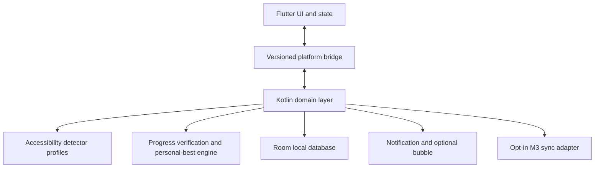

# Rooko — Android software requirements specification

**Version:** 0.3 draft · **Date:** 14 November 2026 · **Companion:** [PRD](PRD.md) · **Status:** Current Rook and progress scope revised; limits/interruption deferred

## 1. Scope, terms, and authority

This SRS specifies the **new** Rooko app, with Android package ID `com.appylab.rooko`. The [BrainPal research ledger](../analysis/brainpal/FINDINGS.md) provides comparative evidence, not source code or an implementation contract. The static APK shows Accessibility and Usage Stats routes, local per-app/day aggregates, a floating service, block decisions, and cloud interfaces. Live tests leave exact cross-app count accuracy and block-screen behavior unresolved. The choices here are intentionally original and must be validated on real devices.

| Term | Meaning |
| --- | --- |
| Supported app | Package and version range with a tested detector profile |
| Candidate | Possible short-form item seen from allowed Android signals |
| Recorded event | Event accepted and persisted by the counter under an enabled app profile |
| Recorded total | Sum of stored counter events for an app and local date |
| Coverage gap | Time when selected app may have been used but detection was unavailable |
| Count band | Fixed range of the combined local daily count that selects a Rook pose |
| Verified day | Completed local day with established consent, service continuity, selected-app set, validated profiles, and timezone evidence |

**User-facing count and time language:** The app maintains one combined sequence of events recorded by the counter. Today may show each selected app's recorded daily total beneath the combined number; Progress Day may show daily app attribution alongside the combined total and measured hourly activity. These subtotals do not create separate sequences. Progress Week and the floating counter use combined counts without per-app attribution. Progress Day pairs “Total Count” with “Time spent,” an approximate local aggregate measured only while a selected recognized Reels or Shorts feed is observed in the foreground. Week may show the sum of daily observed-feed duration only when all seven daily aggregates are available. It excludes gaps longer than five seconds and known interruptions; it does not establish playback or attention and is never inferred from counts, count timestamps, or item dwell. Missing duration data remains unavailable. Older days without complete hourly buckets show a placeholder instead of a fabricated timeline. The interface does not classify counts or explain detector confidence. Internal event categories and coverage fields remain available for detector validation, permissions, and release gating, and are not shown on Today or Progress. Duration collection requires updated affirmative Accessibility consent; overlay access is not needed. Limits and limit-triggered interruptions are deferred; retained legacy values are inert.

**Requirement language:** “shall” is required for the named phase. P0 = M1 local beta, P1 = M2 public v1, P2 = M3 complete v2.0 target. M3 features are part of the final product, while account and friend participation remain optional for each user. Every requirement is free to use. A requirement is complete only with the verification named below. Product-level changes require updating both documents and their traceability entries.

## 2. Platform and architecture

### 2.1 Recommended implementation

Use **Flutter/Dart for screens and the shared Sync design language**, with a **Kotlin Android module** owning Accessibility, service lifecycle, overlay launch, notifications, permission checks, detector profiles, and a single Room database. Kotlin exposes typed state/events to Flutter through a versioned Pigeon or equivalent generated platform bridge. This reuses the user's Flutter experience in Sync Spend, Sync Task, and Sync Focus while keeping Android-only service logic native. The other viable approach is an all-Kotlin Compose app, which reduces bridge complexity but loses direct reuse of the Sync Flutter UI conventions. A pure Flutter plugin-only detector is rejected for M1 because service lifecycle and Accessibility reliability need explicit native ownership.

**Baseline proposal:** Android 10 / API 29 minimum; compile and target the current Play-required SDK at release time. No iOS implementation. Android 12 (the research device) and recent Android versions are mandatory test targets. Build variants: debug, internal, release. Debug-only synthetic event injection must be absent from release. Package name, signing, CI provider, crash-reporting provider, and server hosting are open decisions.

### 2.2 Module boundaries

| Module | Responsibility | Prohibited dependency |
| --- | --- | --- |
| `android/detection` | Accessibility event normalization and per-app profiles | Flutter widget state, network client |
| `android/counting` | Candidate state machine and confidence | UI strings, network client |
| `android/progress` | Room aggregates, coverage verification, personal-best ordering | Flutter widget state, detector event content |
| `android/storage` | Room schema, migrations, transactions, export DAO | Raw Accessibility node text storage |
| `android/platform` | Permission state, lifecycle, notification, bubble, Activity | Business count rules |
| `lib/` | Theme, navigation, screens, presentation state | Direct Accessibility APIs or SQL |
| `sync/` (M3) | Aggregate-only encrypted transport and reconciliation | Media titles, node trees, raw event streams |

## 3. Functional requirements

### 3.1 Onboarding and permissions

| ID | Priority | System requirement | Verification |
| --- | --- | --- | --- |
| FR-001 | P0 | Android startup shall show the native app-icon splash for at least 1,500 ms and shall not show a separate Flutter splash. First launch shall then open a simulated counter preview with “See the counter in action.” as a prominent accessible page title, Instagram Reels and YouTube Shorts logos, an example count sequence, and a “Get started” action. It shall omit the “Illustrative preview only” footer and shall not change local counts or request overlay permission. Next, a blurred transparent Ready Rook SVG appears as neutral dots gather from four corners into a circular orbit beneath “I'm Rook” and “Tap to continue.” Tapping shall move the greeting upward while a concise combined Reels/Shorts count explanation gradually appears beneath it and the Ready Rook SVG clears; the “Hi, Rook” action shall open a setup introduction that keeps the greeting and Reels/Shorts explanation visible while moving them upward and fading them to translucent text, resizing the carried explanation to match the new heading, and settling neutral dotted rings around Ready Rook. The Tap to continue and Hi, Rook actions shall use staggered fade out/in handoffs with brief delays; Hi, Rook shall fade out before the setup page opens, and Okay shall fade in after a brief delay. Reduced motion shall bypass these delays. Its message about setting up access before counting shall fade in below them as letters appear one at a time, and Okay shall open the eight-question sequence and then the five-page animated story before the Rook privacy bridge. Reduced motion shall show the complete message and formed ring without motion; backgrounding shall pause animation. System Back shall step from setup introduction to the reveal, and from the reveal to the blurred introduction. The former Welcome page and “Your feed, on your terms” shall not appear, and onboarding shall not display numbered stage labels. Before Android Settings opens, the tracking disclosure shall explain that Accessibility checks selected app/feed signals, estimates foreground-feed time in bounded intervals, stores only a daily observed-time aggregate locally, does not establish playback or attention, does not retain feed content, and does not require overlay access for time measurement; it shall also explain count signals and how to revoke access. The user must affirmatively consent or decline. | First-launch and Back walkthrough; native splash minimum-duration/build check; preview count and logo check; gathering/reveal motion and reduced-motion check; consent/decline route, measurement disclosure, permission isolation, and screen-reader review |
| FR-002 | P0 | Onboarding shall present the eight user-selected questions and answer sets listed in PRD section 4, in order after Okay. Questions 1 and 3 allow multiple selections; the others allow one. Continue requires a selection. Choosing “I'm still finding it” in question 4 skips dream questions 5–7 and proceeds to question 8. Back and process restart restore the current question and selected answers. Each question shall fade out before forward or Back navigation, then reveal the next heading after a short delay and its answer options afterward; reduced motion shall make navigation and content immediate, and backgrounding shall pause a handoff until resume. On question 2 only, the heading shall show transparent Ready Rook before selection, then Ready, Strained, Injured, or Queasy for the four options in order, including a restored draft choice. Answers stay only in a local onboarding draft, are erased at completion, and do not change live counting, Today/Progress Rook state, or produce medical inferences. No account or purchase is required. | Eight-question answer and branch walkthrough; four heading-art options and draft restoration; forward/Back motion timing, background pause, and reduced-motion checks; single/multi selection, disabled Continue, restart, draft cleanup, large text, and TalkBack checks |
| FR-002A | P0 | After question 8 and before the Rook privacy bridge, onboarding shall show five animated pages based on the user-supplied `onboarding.mp4`: daily/week/month/year count projection from the selected answer; a required two-choice recall question; a matching recall result; an orb-to-head impact sequence using the selected self-report branch and the user-approved statements; and a 120-dot ten-year month grid. The scenario assumes 35 seconds per reel and labels this time estimate illustrative. `1,000+` uses 1,000 as the lower-bound input. Back and process restart restore the story page and recall choice. Reduced motion shows settled content immediately; backgrounding pauses animation. The story never records viewing events, modifies tracking totals, or changes Rook state. Recall draft data is erased at onboarding completion. | Numeric projection and time-math tests; all five pages, answer branches, Back/restart, draft cleanup, large text, TalkBack, reduced motion/background, and Android visual review |
| FR-002B | P1 | Following the five-page story, onboarding shall show a Ready Rook and neutral dotted shield bridge with accurate count-visibility copy, then privacy and consent. Fresh installs default-select installed Instagram and YouTube; Settings permits later changes. The access checklist hosts the optional floating-counter opt-in rather than a separate setup page; it omits per-app availability rows and the duplicate overlay-access paragraph. A final handoff shall offer Today and, when a selected supported app is installed, an allowlisted launch of Instagram or YouTube. Both pages shall use the shared fade-out, pause, and fade-in timing, support Back/draft restoration, reduced motion, and background pause. Neither page shall claim feed blocking, guaranteed recognition, or health effects. | Bridge reveal and route tests; selected/unselected/uninstalled app launch checks; Back/restart, reduced motion, theme, TalkBack, and Android layout checks |
| FR-003 | P0 | On return from Android Settings, the app shall query actual Accessibility service state and selected-package support, and actual overlay permission after optional bubble setup; it shall never infer success from intent return alone. | Grant, decline, revoke, and overlay-denial tests |
| FR-004 | P0 | When required access is missing, Today shall show a permission wall. Allow routes to the in-app Settings destination; X dismisses the wall and leaves a compact permission banner at the top of Today. Do not show “Tracking is off” on Today. | Permission wall, dismiss, banner, grant, revoke, and return-flow test |
| FR-005 | P0 | Accessibility processing shall be scoped to user-selected supported packages and only to fields required for feed/item recognition. | Code review and event-log audit |
| FR-006 | P0 | Revocation shall stop detection and hide the bubble within 5 seconds of the app learning of the change. | Device test |
| FR-007 | P1 | Overlay access shall be explained and requested separately from the access checklist only after the user taps its optional floating-counter action; declining or skipping leaves tracking usable without the bubble. Notification access remains contextual to a future notification feature and is not requested in this UI pass. | Permission-flow test |
| FR-008 | P1 | Battery/OEM restrictions shall be reported as possible coverage gaps with a remediation page, without promising uninterrupted operation. | OEM test matrix |

**FR-001 / FR-002A particle motion refinement (user revision, 2026-11-15):** The Tap to continue corner scatter shall gather and flow into a ring; the Hi, Rook reveal shall intensify that same flow without resetting it on an early tap. Question 8 shall supply the exact daily value to the subsequent 7-day, 30-day, and 365-day count animation, with staggered dot arrivals, soft holds between count phases, and a dense settled sphere. The settled sphere shall keep revolving until Continue, carry its rotation and particle identity onto the recall page, then travel left on Continue. On the result page it shall move from left to center, scatter, and disappear while the result text remains. The impact sequence shall morph its particles into a human profile rather than crossfade static shapes. Check all five answer values, intermediate and settled frames, continuous rotation, both sphere handoffs, early Tap to continue, Back, reduced motion, background pause, and Android device layout.

**FR-001 / FR-002 / FR-002A onboarding pacing (user revision, 2026-11-15):** Every distinct onboarding page shall fade out, hold briefly, then fade and rise in on forward and Back navigation. A page's own heading, choices, and story content shall enter in a staged sequence where applicable. The Rook gathering/reveal phases shall remain one mounted particle scene. Ignore repeated navigation taps during a handoff. Reduced motion shall change pages and reveal content immediately; backgrounding shall pause an unfinished handoff until resume. Verify intermediate opacity, delayed swap, Back, rapid taps, permission return, reduced motion, and lifecycle pause.

**FR-003 / FR-007 onboarding setup guides (user reference adaptation, 2026-11-15):** After the separate Accessibility disclosure and affirmative consent, a dismissible instruction sheet shall explain Android's service grant before opening Settings. The access checklist contains an optional floating-counter action, followed by its own dismissible overlay instruction sheet. Both sheets use neutral UI, device-agnostic steps, reduced-motion behavior, and a clear Not now action. A guide never grants or implies permission; the app still queries actual service or overlay state on return. Do not request background permission or present reference-app claims about blocking or roasting.

The app is a general productivity tool, not proposed as a disability accessibility tool. It shall **not** set `isAccessibilityTool=true` unless its primary purpose and user research genuinely change. Google Play's current [AccessibilityService policy](https://support.google.com/googleplay/android-developer/answer/10964491?hl=en-EN) requires a separate, prominent in-app disclosure, affirmative consent, and Play declaration for this use; the declaration review video shall cover consent and decline flows. The disclosure shall state what app/feed signals are accessed, how they are used and shared, and that user content is not retained. [Play's disclosure guidance](https://support.google.com/googleplay/android-developer/answer/11150561?hl=en) also calls for a clear decline path. Recheck these rules at submission. No UI string may claim data never leaves the device while Firebase Analytics and Crashlytics send technical data, or if opt-in sync is enabled later, without qualification.

**FR-002C / UX-04B first-run welcome (user revision, 2026-11-22):** Completing full onboarding shall queue a one-time modal bottom sheet over Today. It shall show the current Rooko app mark, concise developer and product copy, an accurate support route, a scrollable body, and fixed Continue and Close controls. A brief pink and neutral confetti burst shall play when it appears, without blocking the sheet; reduced motion omits the burst and sheet transition, and backgrounding pauses an unfinished burst. Continue, Close, Android Back, or standard sheet dismissal clears a local pending flag; opening a selected supported app from the final handoff leaves the flag pending for the next Rooko view. Existing completed users shall not receive the flag. The modal barrier shall block Today interaction and screen-reader traversal. Verify fresh completion, selected-app return, restart, dismissal routes, burst and lifecycle, reduced motion, light/dark/AMOLED, large text, and TalkBack.

### 3.2 Detector profiles and count semantics

| ID | Priority | System requirement | Verification |
| --- | --- | --- | --- |
| FR-010 | P0 | The app shall read the installed target app's exact `versionName` locally and resolve its package/version pair through the latest verified detector registry. The registry maps to stable IDs for bounded detector profiles; a profile contains only exact resource IDs and enum values selecting strategies already implemented in the app. Each supported exact-version entry shall include signed validation evidence of at least 200 transitions, at least 100 stationary/non-feed cases, at least three device families, precision ≥98%, recall ≥90%, and zero stationary repeats. Several versions may share one profile only when their relevant feed and item-transition signals are compatible and each mapped version independently passes the FR-012–021 validation gate. Known but unvalidated versions may be catalogued without a profile mapping and shall remain unavailable. Unknown versions shall fail closed. | Registry/profile matching fixtures, unsafe-config rejection, validation-threshold tests, cross-version compatibility evidence, and app-upgrade check; live catalog-only match on RMX2156 is recorded in qa/2026-11-12-detector-registry-live/README.md |
| FR-011 | P0 | After the updated in-app tracking disclosure, affirmative consent, and Android Accessibility access, counting and approximate observed-feed-time measurement shall start automatically for selected apps without a debug switch. Prefer a validated exact-version profile. Installed Instagram and YouTube versions without one may use the package-scoped estimated counter only while its feed and item signals are recognized; missing signals fail closed. Other unsupported apps fail closed. The installed version is detected locally. Time sampling checks only the current package and visible feed-marker IDs; it does not read labels or item identity and does not require overlay permission. | Consent/access lifecycle, installed-version changes, selection, registry validation, home/search/long-video/comments cases, duration pause/restart behavior |
| FR-012 | P0 | The counter shall record an item only after it remains visible in the foreground short-form feed for at least 1,000 ms and passes the profile's identity and duplicate checks. A profile may seed the first candidate on recognized feed entry; later candidates start on a recognized item transition. M0 shall benchmark the 1,000 ms target before public release. | Synthetic timing tests; feed-entry and real-device benchmark |
| FR-013 | P0 | A stable opaque accessible item token, when available and privacy-reviewed, shall be hashed with an app-scoped rotating local salt before transient storage; the plain token shall not be persisted. If no stable token exists, a profile may identify an item only with two independent structural signals (for example recognized feed-entry plus item-container change, or scroll plus feed-item change) and shall record lower confidence. Pager position alone is not item identity. | Code audit and fixture tests |
| FR-014 | P0 | Repeated content-change events or time passing while the same item remains visible shall not increase the count. | Stationary-item stress test |
| FR-015 | P0 | An item revisited within five minutes shall not add a second count. After five minutes, a new viewing session may count it once after a fresh transition and dwell. | Revisit timing tests |
| FR-016 | P0 | Each recorded event shall be attributed to the foreground package and the local calendar date when the counter records it. | Cross-midnight and timezone tests |
| FR-017 | P0 | The native layer shall retain internal event categories and coverage fields for QA. Today, Progress, and the floating counter use one shared total across selected apps. Today and Progress Day may also show per-app attribution. Validated profiles record confirmed events; the consented Instagram/YouTube fallback records estimated events. Estimated days cannot establish verified Progress days. Counts may vary after target-app changes, and no exact accuracy claim is made without a measured corpus. | Combined aggregation, selected-app filtering, estimated-event storage, and Progress verification tests |
| FR-018 | P0 | A fixed HTTPS endpoint shall serve a signed detector registry. The payload shall include a schema version, monotonic sequence, issue and expiry times, exact package/version entries with HTTPS source URLs, catalog/support/disabled status, and shared profile definitions. Schema v2 profiles may contain only an allowlisted strategy ID, exact package-scoped Android resource IDs, and a supported identity-strategy enum with bounded list lengths. Every supported v2 mapping shall carry signed validation summary values meeting FR-010; the publisher and app shall reject missing or below-gate evidence. The app shall reject text selectors, regular expressions, arbitrary class names, runtime-tunable thresholds, executable content, unknown fields, and strategies not already implemented in the APK. Schema v1 remains readable for compatibility and can reference only bundled profiles. The app shall verify the payload against a pinned public key before use; it shall reject malformed or expired payloads, invalid signatures, and sequence rollback. Only a verified, unexpired cached payload may be used offline; an invalid refresh shall not replace it, and an expired cache shall fail closed. Registry requests shall download the complete registry without transmitting device identifiers, selected apps, installed versions, or usage data. The notice shall disclose that the registry host can receive the client's IP address and standard network metadata. A remote profile is not evidence of accuracy; each exact mapped version must pass the FR-010–021 gate before publication as supported. | Signature, schema v1/v2, unsafe-config rejection, validation-threshold, provenance, expiry, offline-cache, rollback, no-upload, and fail-closed fixtures; live endpoint and RMX2156 cache acceptance is recorded in qa/2026-11-12-detector-registry-live/README.md |
| FR-019 | P0 | If a detector crashes repeatedly or exceeds its false-positive threshold, the profile shall fail closed, retain an internal coverage-gap record, and leave local data readable. | Fault injection |
| FR-020 | P1 | Usage Stats/audio fallback may ship only if M0 shows acceptable precision across supported devices; otherwise it shall remain absent from the Reels/Shorts counter. It shall never be mixed into the counter total. | Controlled side-by-side benchmark |
| FR-021 | P2 | The complete v2.0 target shall support validated detector profiles for YouTube Shorts and Instagram Reels only. Known app versions that fail the accuracy gate shall remain unavailable; unknown app versions shall fail closed. | YouTube and Instagram app/version matrix and release review against the accuracy gate |

**Proposed counting state machine:** `OUTSIDE_FEED → IN_FEED_NO_ITEM → CANDIDATE → CONFIRMED → CANDIDATE`, with `COVERAGE_GAP` reachable on permission loss, unsupported version, service death, or detector fault. On recognized feed entry, seed a candidate for the first eligible visible item; after an item transition, seed the new item candidate. Revalidate that the same item remains in the foreground feed after 1,000 ms of monotonic elapsed time before confirming it. Dedupe key = app profile + hashed item token when available; otherwise a bounded transition fingerprint. Keep only the minimum temporary state needed. Feed exit cancels an unconfirmed candidate; an item must be confirmed while its identity and feed visibility can still be revalidated. Device wall-clock changes must not affect dwell timing.

**Accuracy gate for launch:** define a labeled test corpus with at least 200 item transitions and 100 stationary/non-feed cases per launch-supported app across at least three device families and the supported OS range. Ship a profile only with precision ≥ 98%, recall ≥ 90%, and zero repeated increments in the 100 stationary cases. If it misses the gate, keep the profile unavailable; do not add user-facing count-quality labels. These thresholds are proposed release criteria, not established results from REA.

**Instagram/YouTube estimated fallback (user revision, 2026-11-14):** The installed version is detected locally. After the revised disclosure and consent, the app automatically attempts package-scoped feed recognition and text-key estimation for selected Instagram and YouTube installations lacking a validated profile. There is no debug switch. It transiently inspects short visible labels in the bounded candidate subtree, retains at most four for immediate process-local hashing, and persists only estimated events. Returning from Today must preserve the recent item identity; reconnecting while a feed is already visible seeds a baseline rather than recounting the visible item. The shared daily count and optional overlay include estimates, but they cannot validate a profile or Progress day. A changed app version may expose different resource IDs, leaving counting unavailable until the detector is adapted and measured. The broader accuracy gate remains open.

### 3.3 Daily totals, corrections, and progress

| ID | Priority | System requirement | Verification |
| --- | --- | --- | --- |
| FR-030 | P0 | A recorded event and its app/day aggregate update shall commit atomically. Replaying the same event ID shall be idempotent. | Database transaction test |
| FR-031 | P0 | Today shall show one combined daily count across selected apps, the user's compact selected-app logo/count breakdown, and Rook's matching state. Rook uses fixed count bands, shows Sleeping when monitoring is unavailable, and may show Recovering for up to 600 ms after a recent validated feed exit. Overlay permission alone shall not change the pose. The sequence shall not reset or split between selected apps. Do not show limit summaries or access/detection timestamps. Do not show count-quality wording when an estimated Instagram/YouTube path is eligible. When required access is missing, the permission wall/banner routes to Settings. | Today screen with combined counts, pose bands, no estimated-path note, unavailable monitoring, validated feed exit, overlay-only loss, and access-wall states |
| FR-032 | P0 | The user shall not manually add, subtract, or edit counts in Progress. The counter's stored event records are the source of truth. | Progress UI and bridge-call inspection |
| FR-033 | P0 | Today, Progress, and the floating counter shall use the same combined sum of persisted counter events across selected apps. Every event recorded by the counter advances the same daily sequence, regardless of source app. Today and Progress Day may show per-app daily subtotals as attribution; Progress Week and the floating counter use combined counts without per-app attribution. Week may derive coverage-aware insights from the same daily records. Legacy correction deltas shall not change the displayed total; preserve existing rows for migration compatibility. | Mixed-app aggregation, Day attribution subtotals, and shared-sequence fixture |
| FR-034 | P0 | Daily records shall preserve the timezone ID and offset used for each event; a timezone change shall not silently reassign historical events. | Travel and DST test |
| FR-035 | P1 | Progress shall provide Day and Week views backed by existing progress records, with Day on the left, Week on the right, and Day selected initially; no Month view shall appear. Day shall show a measured 24-hour count chart, paired “Total Count” and “Time spent” metrics, and Instagram/YouTube daily attribution rows, with arrows moving one day. Time spent shall be an approximate local aggregate measured only while a selected recognized Reels or Shorts feed is observed in the foreground. Use monotonic intervals no longer than five seconds; do not credit gaps longer than five seconds, screen-off state, Rooko foregrounding, app/feed exit, service interruption/death, consent/access loss, selected-app or version change, or an actual timezone-ID/day-boundary change; a natural UTC-offset change within the same zone does not invalidate daily verification. Measurement does not establish playback or attention and shall never be inferred from counts, count timestamps, or item dwell. Legacy days without stored duration shall show “—”. Duration collection requires the updated in-app disclosure and affirmative consent; overlay access is not required. The chart shall draw slim bars only in hours with recorded counts above a fixed dotted zero baseline, with hour labels aligned to the plot. Tapping, dragging, or accessibility adjustment shall update the selected hour-window and count readout without drawing a second vertical line. For newly recorded counts, the selected hour shall expose individual acceptance times to the second using each event's saved UTC offset for up to seven days. Older counts may show only their latest known time; missing or expired individual times shall never be inferred. A day with counts shall initially select its latest counted hour; a zero-count Today shall select the current local hour and an earlier zero day shall select noon. New counts shall be stored in local-hour buckets atomically with daily totals. Older days lacking complete hourly buckets shall show an honest chart placeholder while retaining the total and app rows. Do not display an active-hours metric. A saved zero day shall show 0 only when coverage is verified; a saved zero with unknown or partial coverage shall display unknown. A missing Day shall show Rook's empty state. Week shall place one combined period total above seven labeled daily bars without grid lines or a duplicate total card, and navigate seven days per arrow. Tapping any weekday column shall open that date in Day view; a missing date shall show the Day empty state. On app resume, refresh the visible Progress range from local records while keeping previously loaded data visible through refresh failure; stale responses shall not replace newer selections. Each saved Week day shall show positive recorded counts; zero shall display 0 only for verified coverage, while an unverified saved zero shall display unknown and a missing day shall show neither count nor bar. If the recorded week total is zero but any day lacks verified coverage, show the total as unknown. Below the graph, Week shall show the highest positive recorded day and a direct Day-view action, the number of days with saved count records, and state that missing days are unknown rather than zero. Show a week-over-week combined-count difference only when both the visible and immediately preceding weeks contain seven verified day records; otherwise show “—” with a completeness explanation. Show a weekly observed-feed-time sum only when all seven daily duration aggregates are non-null; otherwise show “—”. It shall be labeled as approximate foreground-feed observation and shall not imply playback or attention. An empty Week shall show Rook's empty state. A qualifying selected Day or the most recent qualifying day in the visible Week shall show Victorious, its date, and count in a compact callout after the summary or chart; it must be strictly lower than an earlier verified day. The first verified day establishes the baseline. Progress panels, Day/Week controls, and internal separators shall have no visible border strokes. Show no capture-status or count-quality labels, manual count controls, sample data, or paid banner. Ignore stale range responses after changing date or view. | Day/Week navigation, chart and exact-time retention, bounded observed-duration and interruption cases, legacy null handling, consent gate, combined-count and attribution fixtures, verified-week comparison gating, unknown missing-day handling, duration completeness, Day action, verified-day ordering, zero versus missing days, empty periods, stale range response, accessibility semantics, borderless themes, narrow and 200% text layout |
| FR-036 | P0 | The app shall export a human-readable CSV and machine-readable JSON of aggregates, corrections, settings, and coverage gaps using Android's document picker. | Export/import-schema validation |
| FR-037 | P0 | “Delete local data” shall remove all local counts, corrections, goals, temporary identities, and exports under app control, then reset onboarding. | Delete/relaunch audit |
| FR-038 | P1 | M1 shall open Today by default and show each page title level with enlarged icon-only, right-aligned Progress and Settings controls at the top of Today, Progress, and Settings. Each control shall retain its accessible name, selected state, and a touch target of at least 48 dp. On Today, center Rook, the combined count, its caption, and selected-app breakdown together in the remaining content space beneath the date; allow the content to scroll when it exceeds the available height. Progress shall name the daily-record feature across Flutter models/screens, the typed bridge, Android repository/DAO, and current Room storage. Existing saved records and coverage shall migrate from the previous database without data loss. There shall be no Today navigation item or bottom navigation bar. On Progress and Settings, a top-left Back control and Android Back shall return to Today and refresh its count. Hide the top controls while Today's full permission wall is shown. No daily-limit editor or summary is available in the current scope. A later Battle destination requires its own scope and placement decision. | Icon-only top navigation, accessible names and selected state, 48 dp targets, centered Today hero across viewport sizes, Back and system Back, permission wall, large-text layout, bridge call, versioned Room migration, and Settings screen tests; limit controls absent |

**Settings pass (2026-11-18):** The Apps row opens a compact picker with a local draft, Apply checkmark, and Cancel X. Review access opens Android Accessibility settings even when access is already enabled. Floating-counter Settings omits the preview action and estimate caveat. The Appearance label is plain text; its chevron opens one rounded option card with unbordered, unrounded System, Light, Dark, and AMOLED choices. The rest of the Settings groups remain borderless. The published Google Sites policy describes local counts and legacy correction records, seven-day event-time retention, 30-day coverage-gap details, temporary onboarding drafts, bounded Accessibility processing, approximate observed time, optional overlay, detector-registry request metadata (including that host log retention is unverified), and deletion via Android app storage while in-app export/deletion are unavailable. Help & diagnostics remains unimplemented; its proposed scope is recorded separately. Notifications and battery optimization are omitted.

Progress shall retain legacy records as unknown unless their coverage evidence is complete. A day is verified only when consent, service continuity, a stable selected-app set, validated profiles, and timezone are established throughout the day. Any interruption, restart gap, unsupported version, selection/profile change, actual timezone-ID change, or missing evidence leaves it unverified; a natural offset change within the same timezone ID does not. Never infer complete coverage from the absence of a recorded gap. Zero-count days may be verified when the same evidence is complete.

Permission setup and recovery remain in onboarding and Settings. When required access is missing, Today shows the approved permission wall and compact banner; Allow routes to the in-app Settings destination. The optional overlay permission is requested only when the user enables the floating counter.

### 3.4 Deferred limits and interruption

Daily limits, limit-triggered interruptions, pauses, overrides, and dependent challenges are outside the current scope. The requirements below are retained only as historical traceability for a possible future product decision; they are not active acceptance criteria. The app shall not display limit controls or summaries or apply saved legacy limit values.

| ID | Priority | System requirement | Verification |
| --- | --- | --- | --- |
| FR-040 | Deferred | User-selected daily counter-event cap and active weekdays | Not active; no cap editor |
| FR-041 | Deferred | Frozen cap snapshots and effective-date rules | Not active; legacy saved values have no effect |
| FR-042 | Deferred | Limit crossing and interruption request | Not active; no interruption engine or trigger |
| FR-043 | Deferred | Leave-feed, pause, and override interruption surface | Not active; no interruption UI |
| FR-044 | Deferred | Leave-feed action | Not active; no synthetic navigation or interruption action |
| FR-045 | Deferred | Time-bounded override | Not active; no override behavior |
| FR-046 | Deferred | Missed-interruption fallback | Not active; no missed-interruption records or fallback notification |
| FR-047 | Deferred | Stronger timed mode | Not active; revisit only after a separate product decision |

If interruption behavior is proposed again, review current Android background-launch and Play policies before implementation. This section is not permission to launch Activities, show overlays, or send notifications for a cap crossing in the current product.

### 3.5 Bubble, game feedback, and notifications

| ID | Priority | System requirement | Verification |
| --- | --- | --- | --- |
| FR-050 | P1 | Floating counter shall be off by default, require separate overlay access, show the combined daily total, and be movable or dismissible. During onboarding, launch overlay settings without waiting for detector-registry refresh; verify the actual grant after return. Use one of five static transparent count poses selected by the same fixed bands as Today; keep the count badge and place the overlay at the top center on first display. Position the 48 dp dismiss target at the upper-right edge of Rook as a separate overlay hit target; its visible circle shall just touch the mascot artwork without covering it. Keep the count badge centered close beneath Rook for a compact silhouette. Use targeted package-qualified visible-ID queries for feed recognition; show the overlay as soon as the complete installed-version signature matches, without walking the Accessibility tree or waiting for item-label processing. Inspect item labels off the Accessibility event thread and accept the hash only after the current root still matches the feed signature. Instagram 456+ estimates require visible `root_clips_layout`, `clips_viewer_view_pager`, and `clips_video_container` markers. | Band-boundary, permission-route, grant-return, immediate feed display, badge update, same-app Home transition, asynchronous stale-result rejection, device, transparency, initial-position, close-to-art placement, compact badge spacing, dismiss touch target, drag/dismiss, and occlusion checks |
| FR-051 | P1 | Bubble shall hide on monitoring/overlay permission loss, unsupported apps, definite feed exit, another foreground app, and sensitive system screens. Re-evaluate the feed on same-package window-state changes; hide immediately when Instagram Home has no visible Reels signature. Hidden/retained nodes do not qualify. A missing root or partial visible marker set during a content transition may hold an already-visible bubble for at most 1,500 ms; repeated gaps do not extend the deadline, recognition cancels the pending hide, and a window-state transition or expired grace deadline hides immediately if the full signature is still absent. Comments and other definite exits hide immediately. At local midnight, refresh only an already-visible bubble after resolving the current selected app's installed version and feed; cached recognition shall never restore a hidden bubble. | Same-app Reels-to-Home and Home-to-Reels transitions, hidden retained markers, transient partial signatures, repeated root gaps, recovery and expiry, comments, app-switch and permission-loss matrix; visible/hidden rollover and current-profile revalidation checks |
| FR-052 | P1 | Competitive feedback shall recognize verified personal improvement only; it shall never reward total views or longer viewing. | Rules inspection and content review |
| FR-053 | P1 | Progress shall show only the most recent qualifying personal-best day in the visible period; equal or higher counts do not qualify, and the first verified day establishes the baseline. | Strict ordering, period, baseline, and zero-count tests |
| FR-054 | P1 | Notifications shall be opt-in, honor quiet hours, and include a direct route to settings. | Notification permission and schedule tests |
| FR-055 | P1 | A day is verified only when consent, service continuity, a stable selected-app set, validated profiles, and timezone are established for the full day. Interruption, restart gaps, unsupported versions, changed evidence, an actual timezone-ID change, or missing data leave it unverified. A natural UTC-offset change within the same timezone ID, such as daylight saving time, does not invalidate the day. Legacy rows remain unknown; a verified zero-count day is valid. | Checkpoint interruption, process restart, selection/profile/timezone change, daylight-saving transition, zero-count, and migration tests |

### 3.6 Rook brain mascot and animation

| ID | Priority | System requirement | Verification |
| --- | --- | --- | --- |
| FR-056 | P1 | Rook shall have eight explicit states: Ready, Strained, Injured, Queasy, Vomiting, Recovering, Victorious, and Sleeping. Ready through Queasy use the shared `assets/rook/rook.riv`; other poses use their dedicated Rive files. Every state has matching transparent SVG artwork. | State/asset mapping, local asset load, and artwork review |
| FR-057 | P1 | Flutter shall select Rook through a typed state. All Rive motion shall be eye-only, with the body and limbs stationary. Today and Progress animate; use the matching SVG when reduced motion is enabled, when backgrounded, or when Rive fails. | State-selection test; Android motion, background, and fallback checks |
| FR-058 | P1 | The combined local daily count shall select Ready at 0–49, Strained at 50–99, Injured at 100–149, Queasy at 150–199, and Vomiting at 200+. Sleeping takes precedence on Today if consent, monitoring access, or all selected counting paths are unavailable. An eligible estimated Instagram/YouTube path may make a count pose available without extra Today quality copy. A recent validated feed exit may show Recovering for no more than 600 ms while monitoring is available. Overlay permission alone does not change Today state. | Every boundary, combined-app total, unavailable monitoring, automatic estimate eligibility, overlay-only loss, and one-time 600 ms transition tests |
| FR-059 | P1 | Progress shall show Victorious only for the most recent strictly lower verified combined-count day in the visible period. The first verified day establishes the baseline. The floating counter shall use static images for the five count poses and shall not show Sleeping, Recovering, or Victorious. | Verified ordering, baseline, period, count-band, and overlay-image tests |

### 3.7 Later account, sync, friend play, and challenges

Any M3 feature whose scoring or completion depends on a daily limit, override, or interruption is deferred with that scope and requires a separate product decision.

| ID | Priority | System requirement | Verification |
| --- | --- | --- | --- |
| FR-060 | P2 | Free local use shall continue without sign-in; account creation is optional and independently consented. | Sign-out/offline test |
| FR-061 | P2 | If account sync is approved, it shall transfer only daily app aggregates and corrections selected by the user; raw events, accessibility content, and inert legacy limit preferences shall remain local. | Payload audit |
| FR-062 | P2 | Sync reconciliation shall use stable record IDs and per-record versions; duplicate upload/download shall not double counts. | Conflict/retry tests |
| FR-063 | P2 | Friend comparison shall require both invite and acceptance. Shared score is limited to a chosen daily total or verified improvement status; app breakdown is private by default. | Consent and authorization tests |
| FR-064 | P2 | Either participant may revoke a connection, block a user, and request deletion; access checks apply server-side to every read. | API authorization tests |
| FR-065 | Deferred | Limit-relative battle scoring | Revisit after a separate battle/limit scope decision |
| FR-066 | Deferred | Pause challenge and override window | Deferred with limit and override behavior |
| FR-067 | P2 | A free NFC challenge shall allow registration of a user-owned tag and verify a fresh tag scan before completion. Unsupported or disabled NFC shall be identified before selection. | NFC device, replay, and unsupported-device tests |
| FR-068 | P2 | A free step challenge shall request activity-recognition access contextually, use a sensor-supported delta rather than lifetime steps, and have a user-accessible alternative when permission or hardware is unavailable. | Sensor, permission, and accessibility tests |
| FR-069 | Deferred | Challenge setup, completion, and override | Deferred with limit and override behavior; any future challenge must preserve emergency/system access |
| FR-070 | P2 | The release shall contain no billing SDK, paywall, entitlement check, purchase UI, subscription product, ad SDK, or feature gate based on payment. This applies to sync, battles, themes, limits, and challenges. | Dependency, manifest, navigation, and source scan |
| FR-071 | P1 | Settings Support shall provide bundled local release notes and Help & Feedback actions for troubleshooting, feature requests, and support email. Troubleshoot counting shall open as a scrollable modal bottom sheet and refresh on entry and resume; distinguish affirmative tracking consent, actual Accessibility grant, Accessibility service operation, selected-app install/version and coarse counting-path availability, and floating-counter preference/overlay grant. Offer consent-aware Accessibility recovery, overlay recovery only when the counter is opted in, selected installed-app Android app-info, and app-selection navigation. A diagnostic summary shall be generated from an explicit allowlist and displayed exactly before an explicit clipboard copy. Email actions shall open the user's email composer with fixed subjects and recipient; Rooko shall not send. | Formatter, analyzer, Android build, privacy allowlist review, Android settings/email intent review, and manual large-text/TalkBack/theme review; no detector accuracy claim |

### 3.8 Developer Firebase metrics

| ID | Priority | System requirement | Verification |
| --- | --- | --- | --- |
| FR-072 | P1 | Android Firebase Analytics and Crashlytics shall initialize automatically for developer metrics, without a Settings control. Emit only the parameter-free `rooko_app_open` custom event and allow Firebase's standard app/session events and crash reports with technical app/device diagnostics; disable automatic Activity screen reporting, Analytics advertising ID collection, and the `AD_ID` permission. Do not attach user IDs, counts, selected apps, observed-time totals, Accessibility state/content, feed labels, item identifiers, or support diagnostics to Firebase events, keys, or logs. Firebase initialization failure shall not block local app use. The published Google Sites policy reflects this behavior; Settings and onboarding Privacy Policy actions open it in an external browser. | Android manifest and source review; merged-manifest permission check; Firebase payload/config review; startup with Firebase unavailable; analyzer and Android build; release policy-copy review |

## 4. Data specification

The Kotlin layer owns one Room database. All write paths use transactions and versioned migrations. Suggested schema:

| Entity | Key fields | Retention |
| --- | --- | --- |
| `detected_event` | `event_id`, app ID, local date, UTC time, timezone ID, confidence, profile version, hashed transient item key, dwell ms | 7 days by default; never synced |
| `counted_event_time` (current Room v5) | local date, supported app ID, accepted UTC time, original UTC offset | 7 days; local only; aggregate totals remain after expiry |
| `progress_day` (current Room v6) | local date, timezone ID/offset, coverage, nullable observed foreground-feed duration ms | Until user deletes; duration remains null for legacy rows |
| `daily_app_aggregate` | date, supported app ID, confirmed and estimated counts | Until user deletes; optional M3 sync |
| `count_correction` | correction ID, date, app ID, signed delta, reason code, created time | Until user deletes; optional M3 sync |
| `coverage_gap` | start/end UTC, app ID, reason, detector/profile version | 30 days; aggregate status retained |
| `progress_verification` | local date, start/last-checkpoint UTC, timezone ID/offset, selected-app fingerprint, validated-profile fingerprint, process instance | Until the day is verified or invalidated |
| `app_setting` | selected apps, theme, bubble, notifications, animation/reduced-motion preference, tracking consent versions | Until user deletes |
| `challenge_session` (M3) | challenge ID/type, configured target, start/progress/end, completion, override window | 30 days local |
| `sync_metadata` (M3) | account ID, record version/cursor, last sync | Until sign-out/delete |

No media title, URL, text from an Accessibility node, screenshot, contact, message, or full view tree may be persisted. Logs must redact package-specific item tokens, account tokens, Android ID, and any content-bearing strings. A schema migration must preserve totals and corrections or fail safely with an export path.

**Progress migration:** Initial Room creation shall transactionally import existing `daily_count|<local-date>|<app-id>|<confidence>` aggregates and `last_detection_at_ms|<local-date>` values from the current tracking preferences. Keep those source preferences until the Room import commits, and use a Room migration marker so repeated launches cannot import counts twice. Existing v1/v2 `sync_scroll_history.db` files within the Rooko app sandbox, if any, shall be checkpointed and copied to `rooko_progress.db`; Room v3 shall rename `history_day` and `history_verification` to `progress_day` and `progress_verification`. The changed Android package ID cannot access data in the separately installed former app. Room v4 adds hourly counts, v5 adds short-lived individual accepted times without backfilling missing legacy times, and v6 adds a nullable daily observed-feed-duration aggregate; existing rows remain null. Preserve aggregates, coverage, verification rows, and correction rows. Keep the old file as a compatibility backup and use the new file for subsequent writes. Legacy dates have unknown timezone and access continuity; do not manufacture either. Existing correction rows remain for migration compatibility but are not exposed to the user or included in the counter total. Confirmed events require validated profiles; the consented Instagram/YouTube path may add estimated events.

**Deferred limit compatibility:** Existing daily-limit preference values may remain stored for migration compatibility, but the current application shall not display, apply, or synchronize them. They shall not activate limit calculations, interruptions, or overrides.

**Daily verification:** Start a verification candidate only with established tracking state at local midnight. Check consent, service continuity, selected-app/profile fingerprints, process instance, and timezone on a bounded checkpoint schedule. A missed checkpoint, interruption, restart, unsupported profile, selection/profile/timezone change, or missing evidence invalidates the candidate. Complete a day only after the next local-day boundary is verified. Historical legacy rows remain unknown.

**Aggregate invariant:** for each date/app, persisted totals retain the native event categories needed for compatibility and QA. The user-facing total sums the saved event categories across selected apps, preserving counts already recorded; correction deltas do not change it. New confirmed events require validated profiles; selected Instagram/YouTube installations may add estimated events after revised consent and recognized-feed checks. Compaction at 7 days must preserve counted-event totals and the audit. Missing feed/item signals fail closed, and the M0 accuracy and Play policy gates remain open.

## 5. Interfaces and external dependencies

### 5.1 Android system interfaces

- AccessibilityService: explicit user grant, package-scoped event handling, service status, optional global Back action only on user request.
- UsageStatsManager and AudioManager: research-only fallback until benchmark and policy review approve a specific user-visible use.
- `SYSTEM_ALERT_WINDOW`: optional bubble; do not require it for the basic dashboard.
- Notification permission on OS versions that require it: optional reminders only; no current missed-interruption fallback.
- Room/SQLite: sole source of local count truth.
- HTTPS detector-registry fetch: downloads one signed registry shared by all installations without device-specific values. The verified signed envelope and highest accepted sequence are cached locally outside Room and revalidated before profile resolution.
- Android document picker: export without broad storage access.
- NFC and activity-recognition interfaces in v2.0: used only for a challenge the user selects; neither is required for local counting or emergency/system access.

### 5.2 Flutter/native bridge contract

Version 1 bridge operations include `getCapabilities()`, `getTrackingStatus()`, `setSelectedApps(ids)`, `watchToday()`, `queryProgress(range)`, and `setBubbleEnabled(bool)`. Legacy correction methods may remain for migration compatibility but are not called by the Progress UI. `queryProgress` returns real local counter totals plus verified-day metadata for the requested range. Every response carries a typed success/error result, bridge schema version, and UTC timestamp. `watchToday` sends immutable snapshots, including the latest validated feed-exit signal. Calls are idempotent where a command ID is supplied. The native module must continue counting and checkpointing while Flutter UI is not alive. Export and deletion remain planned operations but are unavailable in this UI pass.

### 5.3 Proposed M3 server contract

No BrainPal host, route, key, or identifier is reused. The free v2.0 server must be designed and documented separately. Candidate REST resources: `POST /v1/sync/batches`, `GET /v1/sync/changes?cursor=`, `DELETE /v1/account/data`, `POST /v1/friend-invites`, `POST /v1/friend-invites/{id}/accept`, `DELETE /v1/friends/{id}`, and `GET /v1/battles/{id}`. Each write needs an idempotency key; each read checks authenticated membership. Authentication, rate limits, deletion SLA, region, and operating budget are release gates for M3 rather than assumptions of M1.

## 6. Nonfunctional requirements

| ID | Requirement | Verification |
| --- | --- | --- |
| NFR-01 | 95% of recorded events shall update persisted totals within 2 seconds on supported test devices; no data loss after process kill. | Instrumented latency and kill tests |
| NFR-02 | Detector shall have bounded queues and avoid heavy tree scans on every content-change event; target incremental battery cost below 3% per 24 hours on benchmark device. | Perfetto/battery benchmark against idle baseline |
| NFR-03 | UI shall cold-open to cached Today in under 2 seconds on a midrange device; progress query for 90 days under 500 ms. | Performance test |
| NFR-04 | Crash-free sessions target ≥99.5%; detector faults shall not crash the host app. | Beta telemetry and fault injection |
| NFR-05 | Local data shall be protected by Android app sandbox; sensitive M3 tokens use Keystore-backed storage. No cleartext network traffic in release. | Security review and manifest scan |
| NFR-06 | UI shall use Google Sans as its global typeface with a system sans fallback. Light shall use white canvas/cards, Dark neutral near-black layers, and AMOLED pure black surfaces. General primary text shall remain black/white. Dark and AMOLED selected controls shall use near-black `#303030` fills with white selected labels and icons for contrast; progress and other controls remain monochrome. Neutral gray may also be used for supporting text, outlines, dividers, and disabled states. Only Rook artwork and supported-app logos may retain color. UI shall support TalkBack, 200% font scaling, 48 dp touch targets, reduced motion, and WCAG 2.2 AA contrast where applicable. | Theme/token inspection, contrast measurement, and accessibility audit |
| NFR-07 | English is initial language; all strings externalized for localization. Timezone, date, and plural forms use locale APIs. | Pseudolocale and locale tests |
| NFR-08 | Export and deletion shall work offline. No account or analytics service may block local counting. | Offline test |
| NFR-09 | Release builds shall exclude debug event injection, verbose Accessibility logs, test hosts, and unused permissions. | CI artifact scan |
| NFR-10 | Store policy, privacy notice, and data safety answers shall reflect actual release build behavior and every SDK included. | Pre-release compliance review |

## 7. Verification plan and release gates

### 7.1 Test layers

1. **Pure rules:** count-band boundaries, recovery window, dwell, duplicate window, local-day boundary, corrections, verification policy, and strict personal-best ordering.
2. **Android integration:** service connection/revocation, foreground-package changes, Room migrations, process death, notification and overlay failures.
3. **Real-app matrix:** supported app version × Android version × device/OEM, including Shorts, long videos, comments, ads, repeat items, stationary playback, rapid swipes, offline use, and app upgrades.
4. **User experience:** setup comprehension, screen reader, large text, dark/AMOLED, permission refusal, and one-handed use.
5. **Mascot:** every Rook state transition, reduced-motion frame, background pause, and SVG fallback. Revisit NFC/step challenges only if their deferred scope is approved.
6. **Privacy/security:** payload and log inspection, consent states, export/delete, M3 authorization and free-feature access.

### 7.2 Mandatory release scenarios

| Scenario | Expected outcome |
| --- | --- |
| 20 content-change events on one stationary Short | One count at most |
| Two separate supported Shorts, each viewed over dwell threshold | Counter records two events if the profile passes its identity/transition gate |
| Long-form video, comments, search, or home feed | Counter records no short-form event |
| Same item revisited within five minutes | No additional count |
| Accessibility revoked mid-session | Status changes, coverage gap starts, no new count, and any active day-verification candidate becomes invalid |
| Process killed after accepted event | Event and aggregate agree after restart |
| Cross midnight, DST, timezone change | Each event remains on its recorded local date; progress marks change |
| Export then delete | Export parses; local database and identity state reset |
| Combined count crosses 49, 99, 149, or 199 | Today and floating counter switch to Strained, Injured, Queasy, or Vomiting; count remains combined across selected apps |
| Consent, monitoring access, or every selected validated/estimated counting path is unavailable | Today shows Sleeping; overlay permission alone does not change the Today pose |
| Validated feed-exit signal is recent | Today shows Recovering once for no more than 600 ms, then returns to the count pose |
| Reduced motion, app background, or Rive failure | Today/Progress show matching transparent SVG; body remains still |
| Full-day tracking evidence is interrupted, missing, or changes | Day remains unverified; no personal-best celebration is inferred |
| A completed day has zero count and complete evidence | Day is verified and may establish a baseline; it qualifies as a personal best only if strictly below an earlier verified day |
| A strictly lower verified day appears in the visible Progress period | The most recent qualifying day shows date, combined count, and Victorious |
| Installed app version maps to a profile already bundled and validated | That shared profile resolves for the exact installed version; compatible validated versions can share the same profile ID |
| Installed version lacks a validated mapping | Instagram/YouTube may count estimated events when their recognized feed and item signals remain available; other apps and missing signals record no new count |
| Validated YouTube and Instagram events are recorded on one selected day | Today shows their per-app attribution beneath the combined total; Progress and floating counter use the same combined total |
| Previously saved event records use an older internal category | Their counts remain included in the shared total; the category itself stays hidden |
| Registry fetch is offline or invalid | Use only an unexpired, signature-valid cache; otherwise fail closed without sending installed-app details |
| Registry signature is invalid, expired, malformed, or sequence rolls back | Reject it and retain a still-valid prior cache; expired prior data no longer enables counting |
| M3 sync duplicate/retry | No double counting or unauthorized friend read; no paid gate |

### 7.3 Go/no-go gates

- Brand name and mascot originality plus name availability checked; Sync family visual review complete.
- Current Play Accessibility, overlay, and data-safety policy reviewed for the exact release build.
- Every feature is free; the release dependency and navigation scan finds no billing, ads, paywall, or payment entitlement gate.
- All eight Rook states use eye-only animation and matching transparent SVG frames; reduced-motion/background/failure fallback passes, and the counter uses the five static count poses.
- Every launch-supported detector meets the corpus gate in FR-010–020. Unsupported versions fail closed.
- Complete v2.0 review covers the two in-scope app families in FR-021 and their validated app versions.
- Privacy notice matches verified data flows. Local deletion and export pass on device.
- Limits, limit-triggered interruptions, and overrides are absent from the current UI and behavior.
- Performance, accessibility, and crash targets pass on the agreed device matrix.

## 8. Traceability and open technical decisions

| Research observation | Product/SRS response | Source |
| --- | --- | --- |
| Accessibility service and monitored packages are declared; live YouTube count changed | Package-scoped native detector and status UI | [Findings](../analysis/brainpal/FINDINGS.md) |
| Fallback uses usage events plus audio identity; 750 ms dwell and five-minute cache are static; exact reel identity unresolved | Benchmark it and keep estimates separate from confirmed counts | [Fallback trace](../analysis/brainpal/evidence/fallback_counter_trace.md) |
| Local daily per-app rows exist | Atomic daily app aggregates and corrections | [Findings](../analysis/brainpal/FINDINGS.md) |
| Floating service checks overlay permission | Optional bubble with separate permission | [Findings](../analysis/brainpal/FINDINGS.md) |
| Block trigger and control callbacks are static; live overlay was not reached | Original interruption and explicit Leave/override semantics | [Block trace](../analysis/brainpal/evidence/apkanalyzer_block_controls_trace.md) |
| Onboarding has multiple answer/analytics paths, with some persistence unresolved | Minimal optional onboarding and no content-bearing analytics | [Findings](../analysis/brainpal/FINDINGS.md) |
| Stats routes and headers are static; no traffic captured | Local-first M1 and independently designed opt-in M3 API | [Network trace](../analysis/brainpal/evidence/apkanalyzer_network_client_trace.md) |

**Decisions still required before release:** final public name; target markets/languages; exact Android minimum; first supported social-app versions; whether the M0 detector gate is feasible; free cloud operating budget and server region; Firebase data-retention and Play Data Safety disclosures; verification that the Settings and onboarding Privacy Policy links open the updated public page at https://sites.google.com/view/rooko/home. Firebase Analytics and Crashlytics now initialize automatically, without Accessibility or counter payloads. Rook's eight-state transparent SVG/Rive implementation is wired to the current count and verified-progress rules. Daily limits and interruptions remain deferred. Resolve detector and policy gates before promising a release date.
