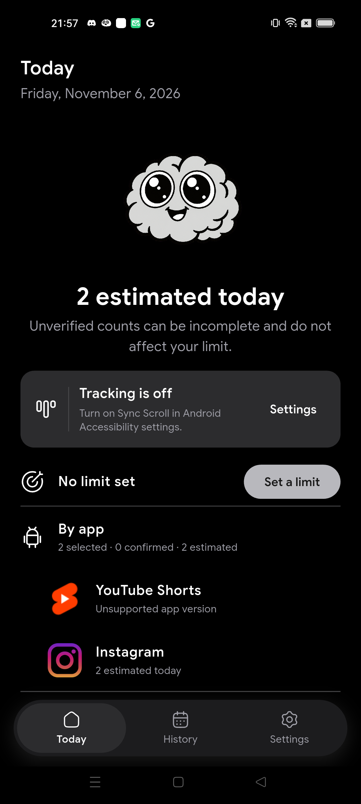
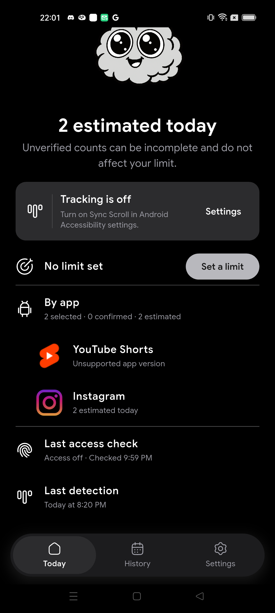
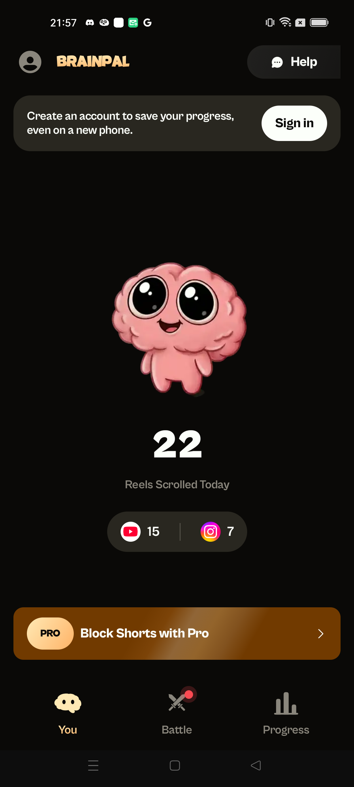

# Sync Scroll Today homepage audit

**Scope:** Sync Scroll Today in dark mode on RMX2156 (1080×2400), with BrainPal's main screen as a same-device comparator. The audit covered the first view and one scrolled view. No product screens were changed.

**User goal:** Understand today's short-form activity, how trustworthy the count is, whether a limit is active, and what to do next.

## Screens reviewed

### 1. Sync Scroll Today, first view — mixed

Today shows 2 estimates, 0 confirmed counts, access off, no saved limit, YouTube unsupported, and 2 selected apps. The page is honest about uncertainty and uses the approved colored app icons. Rook and the explanatory copy take substantial vertical space before the app breakdown.

### 2. Sync Scroll Today, scrolled — information is present but buried

“Last access check” and “Last detection” exist below the app list. The first view barely exposes the access row; a scroll is needed to see both timestamps. Scrolling also leaves Rook partially clipped at the top edge.

### 3. BrainPal You home — stronger glance hierarchy, different product

BrainPal puts one large daily number and a compact per-app split in the same view. The screenshot also includes an account prompt, a Pro offer, Battle/Progress navigation, and a different mascot. Those elements conflict with Sync Scroll's free scope, three-destination M1 navigation, and original Rook direction; they are not recommendations to copy.

## What is working

- Count confidence and permission loss are visible instead of presenting the estimates as confirmed.
- The selected app names and colored logos make the app breakdown easy to scan.
- The daily limit has a direct entry point, and the three bottom destinations match the product contract.
- The high-contrast dark screen appears readable in this capture; the UI tree exposes labels for the three navigation destinations and labels Rook as an image.

## Gaps and risks

1. **The count story needs a stronger hierarchy.** Rook occupies the hero before the number, while the estimated label and long disclaimer split the metric. BrainPal's count and app split are faster to scan. Keep the confidence disclosure, but make it a compact badge or secondary line beside the metric.
2. **A mixed-confidence headline can hide confirmed counts.** In `today_home_screen.dart`, `countTitle` chooses the estimated count whenever any estimate exists. If a future day has both confirmed and estimated events, the headline will not show the confirmed total. Show confirmed total as the primary metric and estimates separately.
3. **The access action is ambiguously named.** The tracking-off card's button says “Settings,” while the persistent navigation also has “Settings.” Rename the card action to “Open access settings” or “Enable tracking” so it cannot be mistaken for the app's Settings destination.
4. **Freshness is below the first view.** The last access check and last detection timestamps are after the app list. Surface the last successful detection or a concise “Updated …” line next to the count.
5. **The quality state is explanatory copy, not a quick badge.** A compact label such as “Estimated” or “Partial coverage” would be easier to scan, while retaining the reason in supporting text.
6. **The Rook is static on Today.** UX-05 calls for an animated Rook state and a reduced-motion frame. The current screen loads a static SVG; the Rive state is not connected to this page.
7. **No recent trend appears on Today.** A small 7-day preview could make the page feel more informative. Keep the full chart and correction detail in History, and do not draw uncovered days as zero.
8. **The PRD's raw/adjusted detail is absent.** SRS FR-031 calls for adjusted total and raw/adjustment detail. The current screen shows confidence totals and per-app rows but no correction summary.

## Recommendations

1. Recompose the hero around the confirmed total, with an adjacent Rook and a clear confidence badge. When only estimates exist, label them as estimates and do not imply a confirmed total.
2. Compress the tracking-off card to one clear status and a uniquely named Android access action. Put “Last detection” near the hero so freshness is visible without scrolling.
3. Make the app split more compact and glanceable, preserving the app logos and a per-app confidence/support label.
4. Wire the Rive state to Today and keep the static SVG for reduced motion.
5. Consider a small trend preview only after the daily data model can represent coverage gaps and confidence. Keep detailed trends and corrections in History.

## Evidence limits

This comparison covers the two dark-mode screens on one RM device. The displayed totals use different app implementations and are not a measurement-quality comparison. Light mode, TalkBack, font scaling, reduced-motion behavior, and longer-run freshness were not tested; screenshots alone cannot establish accessibility compliance.
